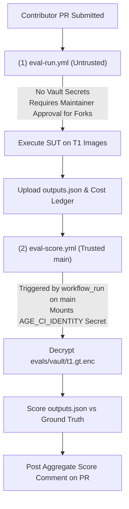

# Contributing to RecipeBoxer

Thank you for contributing to RecipeBoxer! This guide outlines development setup, testing standards, architectural invariants, evaluation tiers, and the CI security model.

---

## 1. Development Setup

RecipeBoxer consists of a Python backend (FastAPI, SQLite, OCR/VLM pipeline) and a React/TypeScript frontend (Vite, TailwindCSS).

- **Quickstart & Requirements**: Refer to the root [README.md](file:///storage/emulated/10/AntiGravity/Workspaces/recipeboxer/README.md) and execute `./setup.sh` to initialize the project environment.
- **Python Toolchain & Cache Discipline**:
  - Virtual environments and caches must be kept on native storage (`$HOME/.cache/...`), particularly in Android VM environments, to avoid FUSE/shared-storage locking overhead:
    ```bash
    PROJECT_CACHE_DIR="$HOME/.cache/projects/$(basename "$PWD")-$(pwd -P | sha1sum | cut -c1-8)"
    python="$PROJECT_CACHE_DIR/venv/bin/python"
    ```
- **Dependencies**: All added dependencies must be open-source and compatible with GPLv3 / MIT licenses (see Invariant 8 in [_agents/INVARIANTS.md](file:///storage/emulated/10/AntiGravity/Workspaces/recipeboxer/_agents/INVARIANTS.md)).

---

## 2. Test Tiers

Tests are categorized into three distinct operational tiers:

| Tier | Marker / Execution | Requirements | Description |
|---|---|---|---|
| **`offline`** | Default `pytest` (e.g. `pytest tests/ -m "not live and not score"`) | None (no network or API keys) | Deterministic unit and integration tests using mocked or recorded responses. Verifies schemas, parsers, exporters, and anti-cheat static invariants. |
| **`live`** | `@pytest.mark.live` | `GEMINI_API_KEY` | Real model inference calls against Google Gemini. Subject to pre-run cost estimation and rate limits. |
| **`score`** | `@pytest.mark.score` | `RB_EVAL_AGE_KEY_FILE` (age identity) | Scorer execution evaluating SUT outputs against decrypted ground truth in the vault. Reserved for CI and maintainers. |

To run the offline test suite:
```bash
PYTHONPYCACHEPREFIX="$PROJECT_CACHE_DIR/pycache" $python -m pytest -o cache_dir="$PROJECT_CACHE_DIR/pytest" -m "not live and not score" -q
```

---

## 3. Anti-Cheat Architectural Invariants

RecipeBoxer enforces strict ground-truth segregation and evaluation integrity. All code changes must conform to the anti-cheat invariants detailed in [_agents/INVARIANTS.md](file:///storage/emulated/10/AntiGravity/Workspaces/recipeboxer/_agents/INVARIANTS.md):

1. **INV-AC1 (No Answer Key)**: Nothing in `recipeboxer/` may read `tests/`, `evals/`, test manifests, the ground-truth vault, or evaluation identity keys. Both runtime stack inspection and static AST tests strictly enforce this.
2. **INV-AC2 (No Filename Meaning)**: Filenames and card identifiers are strictly opaque keys; only natural sort order may be used as a sequence prior. Regex or keyword checks (e.g., `front`, `back`, `card\d`) are forbidden in production code.
3. **INV-AC3 (No Corpus Content)**: Ground-truth recipe titles, distinctive recipe text phrases, and 64-hex SHA-256 corpus hashes are banned as literals or embedded assets in production code.
4. **INV-AC4 (No Silent Fabrication)**: Pipeline and model failures must produce typed `StageFailure` events routed to Human-in-the-Loop review; silent fallback to synthetic or canned recipes is prohibited.
5. **INV-AC5 (Black-Box Evals)**: System Under Test (SUT) runs in an isolated subprocess. Ground truth is decrypted exclusively by the external scorer (`evals/score.py`) after SUT execution completes.
6. **INV-AC6 (LLM Required)**: Multimodal LLM inference is mandatory for recipe transcription. Without an API key, the pipeline enters an onboarding/blocked state. OCR is an assistive signal, never a replacement model.

---

## 4. What Contributors Can Run

Contributors can test and debug locally across the following datasets:

- **Tier T0 (Training / Fixtures)**:
  - Full access to 48 synthetic fixture cards in `tests/fixtures/sample_cards/` and `manifest.json`.
  - Permitted to run full pipeline extraction, grouping, and detailed per-item diffs.
- **Tier T1 (Dev-Eval Images)**:
  - Image files for Tier 1 are publicly available in the repository.
  - Contributors may run the production pipeline locally on T1 images using their own `GEMINI_API_KEY` for integration testing.
  - **No local scoring**: Ground truth for T1 is age-encrypted in `evals/vault/t1.gt.enc`. Contributors do not possess the vault identity keys and cannot generate local evaluation scores. Official scores are generated exclusively through CI.

---

## 5. Official Evaluation via CI Two-Workflow Split

To prevent untrusted code in pull requests from accessing ground truth or consuming unauthorized API quotas, CI scoring uses a strict **two-workflow split**:



1. **Workflow 1: `eval-run.yml` (Untrusted PR Execution)**:
   - Checks out the PR code.
   - Runs with **NO vault identity secrets**.
   - For external forks, execution of live LLM evals requires explicit maintainer approval (GitHub environment reviewer or label) to guard API quotas.
   - Executes the SUT against T1 images and publishes `outputs.json` and cost ledger as workflow artifacts.
2. **Workflow 2: `eval-score.yml` (Trusted Scorer)**:
   - Triggered automatically via `workflow_run` after `eval-run.yml` completes.
   - Checks out **trusted scorer code from `main` only** (untrusted PR code is never executed in this workflow).
   - Injects the repository secret `AGE_CI_IDENTITY` into the environment.
   - Downloads `outputs.json`, decrypts `evals/vault/t1.gt.enc`, and computes aggregate accuracy metrics.
   - Posts aggregate metrics as a PR comment (rate-limited to prevent leaderboard overfitting).

> [!CAUTION]
> **Security Guardrail: Never Use `pull_request_target`**
> Workflows in this repository must **never** use `pull_request_target` to check out or execute PR code in the presence of repository secrets. Untrusted code must remain completely isolated from the ground-truth vault and API secrets.
