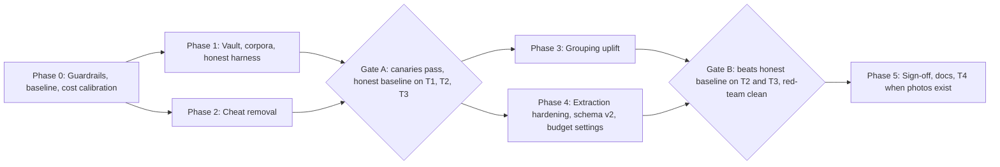
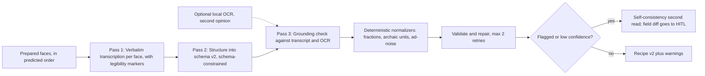

# RecipeBoxer: Remove Eval Cheats, Rebuild Honest Evals & Improve the Pipeline (v2)

A phased plan that swarms of sub-agents can carry out.
**v2 changes:** includes your answers (§1), adds a **ground-truth vault** (§3), **user-facing budget/quality settings** (§7), notes on the **SDK trade-offs**, a **schema v2 with no backward-compatibility**, and **OCR as a complementary signal (not a fallback)**.

> [!IMPORTANT]
> **Overall goal.** Every reported score must come only from **pixels → live model → our code**. Ground truth (GT) is visible **only to the scorer**. Production code and the agents implementing it never see it, but they *can* run the production pipeline on the eval images as integration tests.

---

## 1. Decisions Log

| # | Question | Your answer | What the plan now does |
|---|---|---|---|
| D1 | Real scans | None on hand; use the web if possible, otherwise wait | New **T3 "real-web"** tier built from public-domain archives that have human transcriptions (§3.3). **T4 "real-user"** slot is reserved for your photos later. Multi-card grouping on real images has to wait for T4 (archives are mostly single pages). |
| D2 | Gemini budget | Agents may use the key; you're unsure how to express limits; should become an app setting | §7: **quality profiles + spend caps + rate limits + pre-run cost estimate** in the app; the harness reuses the same mechanism for eval caps. WP-B0 runs a **calibration run** to measure real cost per card before any caps are fixed. |
| D3 | `google-genai` SDK | OK, but what are the downsides? | Adopt it behind our own `LLMClient` interface. Downsides and mitigations are in §8.1. |
| D4 | Schema / legibility UX | Fine; no backward compatibility needed | Schema v2 replaces v1 outright. Exporters and the frontend are updated directly. A new frontend WP shows "hard to read" indicators (§8.2, WP-F1). |
| D5 | No API key | LLM required; OCR may *assist*, never replace | With no key, the app shows an **onboarding/blocked state** and no analysis runs. Local OCR (optional WP-O1) is a *second opinion* for grouping cues and grounding, kept only if ablations show it helps. |
| D6 | GT secrecy | Hidden from eval workers and production; only the scorer uses it | §3 **GT vault**: encrypted GT, scorer-only key, tiered corpora, aggregate-only feedback. The generator and its templates move out of the shipped package. |
| D7 | Keys across machines & contributors | Needs to work for multi-machine development and external contributors | §3.4: one **`age` key per maintainer/machine** (multi-recipient vault); CI scoring via a **two-workflow split** (untrusted run with no key → trusted scorer from `main`); maintainer-approved live runs for forks; dedicated low-quota CI Gemini key; T2 runs only on trusted refs. |
| D8 | Synthetic card generator | Refactor into a separate directory/project; split to its own repo later | WP-V2: new top-level **`cardforge/`** project with its own `pyproject.toml`, no imports from `recipeboxer`, consumed only by `evals/`. |
| D9 | Real collections are homogeneous | Large groups on the same stationery and age | §9.1: physical similarity weighted **relative to the collection**; **content continuity** as the main signal; per-card physical evidence (show-through, mirrored wear); homogeneous-deck corpora and metrics reported separately; WP-G10–G13. |

---

## 2. Current State (from the audit)

| Area | Fact | Ref |
|---|---|---|
| Corpus | 48 **synthetic** images, 24 recipes (6 categories × 4). No real scans; the README's provenance wording overstates this. The GT text is also in `recipeboxer/tools/card_generator.py` (templates), i.e. **in the shipped package and readable by every agent**. | `tests/fixtures/sample_cards/`, `card_generator.py:1419-2263` |
| Answer-key lookups in production | Manifest SHA/filename → recipe, cluster, modality | `extractor.py:125-193,680-770` · `semantic.py:48-71,262-278` · `router.py:35-58,337-392` |
| Filename cheats | Role, ruling, ink, stains and continuation text invented from names; `card N front/back` regex | `fingerprint.py:~253-379` · `heuristics.py:512-567` · `router.py:77-107,399-427` |
| Canned recipes | Cinnamon rolls / lemon bars / fudge / pecan | `extractor.py:773-901` |
| Harness leaks | Original SHA survives obfuscation; GT attributes passed to the system under test (SUT); extraction runs on GT clusters; mock judge on by default; global de-obfuscation registry | `obfuscation.py:271` · `runner.py:467-522,718-722` · `tests/fixtures/loader.py:195` |
| LLM plumbing | Raw httpx; no `response_schema`; **no retries**; MIME hardcoded `image/jpeg`; thinking off; silent fallback to fake output in all three stages | `extractor.py:551-645` · `fingerprint.py:222-238` · `semantic.py:204-227` · `config.py:31,40` |
| Grouping | Greedy chaining; O(N²) pair verification run one call at a time; EXIF unused | `optimizer.py:89-223` · `semantic.py:185` |
| Schema | `ingredients: List[str]`; no sections, confidence or provenance; domain normalizers are never called | `models/recipe.py`, `agent/skills/*/parser.py` |
| Tests | ~1,633 Python tests; about 45 depend on the cheats (§10); 31 frontend tests are unaffected | — |

---

## 3. Ground-Truth Vault & Corpus Tiers (D6, D1)

### 3.1 Corpus tiers

| Tier | Contents | Images visible to implementers? | GT visible to implementers? | Purpose | Scores reported? |
|---|---|---|---|---|---|
| **T0 train** | The existing 48 fixtures plus any freshly generated synthetic decks | Yes | **Yes** | Unit tests, fitting feature weights (WP-G5), confidence calibration (WP-G8), prompt iteration, debugging | Never as quality claims (labeled "train") |
| **T1 dev-eval** | New synthetic decks generated by the **Eval Curator** from recipe text *not in the repo*, with opaque names, plus misleading-name variants | **Yes** (so production can be integration-tested on them) | **No** | Day-to-day honest measurement | Aggregate metrics + per-category breakdown only |
| **T2 held-out** | Same generator, separate recipes/seeds/styles; more 3–5-face sets and distractors | **No** (released only to the scorer at gates) | **No** | Gate A and Gate B decisions; guards against tuning on T1 | Aggregate only, at gates only |
| **T3 real-web** | Public-domain photos of real handwritten/printed recipes with **human** transcriptions (§3.3) | Images yes (they're public), but names are opaque in the repo | **No** | Real-world extraction quality; standalone / no-false-merge grouping | Aggregate only |
| **T4 real-user** | Your photos (later), including multi-card sets | Per your preference | **No** | The number that matters most | Aggregate only |

### 3.2 Vault mechanics (WP-V1, WP-V2)

- **Storage:** GT for T1–T4 is committed only as encrypted files (`evals/vault/<tier>.gt.enc`, using `cryptography` Fernet or `age`). Plaintext GT never touches the repo or the workspace.
- **Key:** an `RB_EVAL_KEY` environment variable set **only** for the scorer step. The SUT subprocess runs with a scrubbed environment (WP-E3), and implementer agents are never given the key. You or the orchestrator hold it; it never goes in the workspace.
- **Scorer:** a separate CLI, `evals/score.py` (outside the `recipeboxer/` package). It reads the SUT's output JSON plus the vault and writes the report. Production code has no import path to it, and a static test enforces that.
- **Feedback policy:** T1 returns aggregate and per-category metrics only, never per-image diffs. Per-image diffs are allowed only on T0. Scoring T1 is rate-limited (e.g. ≤ 10 runs/day) to slow adaptive overfitting, the way Kaggle-style leaderboards do.
- **Remove existing exposure:**
  - Move `card_generator.py` (engine and templates) from `recipeboxer/tools/` to `evals/generator/`, unless you want card generation as a product feature, in which case keep the engine and move only the templates.
  - The current 48-card manifest is already in git history, so it is **demoted to T0** and never used for claims.
- **Eval Curator agent (isolated):** generates T1/T2 and curates T3. It writes GT **straight into the encryptor** via a script, so plaintext never lands on disk. Its outputs are images plus `.gt.enc`.

> [!WARNING]
> **Limits of the secrecy.** Within one VM and one workspace, the secrecy is *procedural*, not cryptographically airtight. Agent transcripts live under `.gemini/antigravity/brain/`, and an implementer *could* look at T1 images and hand-type answers into code. Mitigations:
> 1. Implementers are instructed not to read other conversations' logs.
> 2. The anti-cheat static tests (§5.3) run with a deny-list the scorer generates from decrypted GT. Production fails if it contains any GT title or distinctive phrase, or any corpus image hash.
> 3. T2 images are never shown to implementers.
> 4. The red-team audits for this at every gate.

### 3.3 Real-web corpus (T3) sourcing (WP-R1, WP-R2)

| Source | License | Why it's useful | Caveats |
|---|---|---|---|
| **Smithsonian Transcription Center** (transcription.si.edu) | Largely **CC0** (Smithsonian Open Access) | Volunteer transcriptions reviewed by Smithsonian staff; recipe cards and cookbooks | Check CC0 per item; transcriptions are verbatim, not structured |
| **Library of Congress "By the People"** (crowd.loc.gov) | Mostly public domain | Handwritten recipes inside personal papers, with transcriptions | Well-known items (e.g. Rosa Parks' pancake card) may have been **memorized by models** |
| **Wikimedia Commons** (`Category:Recipe cards`, handwritten recipes) | PD / CC-BY / CC-BY-SA (per file) | Real photographed cards, often index-card style | Usually no transcription, so GT must be hand-made |
| **FromThePage** (manuscript cookbooks) | Varies by host institution | Manuscript recipe books with transcriptions | Check the license per collection |

**Curation pipeline (Eval Curator, isolated):**
1. A `flash` search agent collects 30–60 candidates and records URL, license, attribution and the human transcription. Only CC0, PD and CC-BY/BY-SA items are kept; attributions go in `evals/corpora/real_web/ATTRIBUTION.md`.
2. **Memorization probe:** ask the extraction model to "complete the recipe" from the title alone. Items it reproduces closely are excluded, because models may have seen these archives during training.
3. **Build the GT:** verbatim transcription = the human transcription (trusted). The structured GT is drafted **text-only** (never from the image) by a *different* model tier than the one used for extraction, then you **spot-check ~20%**. This stops GT drifting toward the model's own reading of the image.
4. **Images:** download, apply EXIF orientation, give opaque names, store them, and encrypt the GT.
5. **Coverage limits:** mostly single pages, so T3 measures **extraction** plus **standalone / no-false-merge** grouping (real items shuffled into synthetic decks as distractors). **Multi-card grouping on real images waits for T4.**

**T4 photo guide (for you, later):** 10–20 recipes, of which at least 5 are multi-card or front/back. Use a phone camera with natural framing, some skew and glare, and the camera-roll order as captured (that's a legitimate signal). Include a typed transcription per recipe. The intake script (WP-R3) handles hashing, GPS stripping (it keeps the capture timestamp) and encryption.

---

### 3.4 Keys, multiple machines & external contributors (D7) (WP-V3, WP-CI1)

**Principle:** the answer key and the Gemini key are only ever used by **trusted code on trusted machines**. Contributors' code can be *run* against eval images but never *in the same process or job* as the answer key.

| Concern | Design |
|---|---|
| **Encryption** | Use **`age` with one public key per maintainer** (via the `pyrage` Python binding, or the `sops` + `age` CLI) instead of one shared symmetric key. The vault is encrypted to every maintainer's public key plus a CI key; each private key stays on its own machine. Adding or removing a maintainer means re-encrypting to the new recipient list (`evals/vault.py rekey`). The recipient list lives in `evals/vault/recipients.txt`. |
| **Your multiple machines** | Each machine gets its own `age` identity, stored in the OS keyring or `~/.config/recipeboxer/age.key` (outside the workspace, mode 600). Add each machine's public key to `recipients.txt` and rekey. **Nothing secret is ever committed or synced through the workspace.** |
| **External contributors (local)** | Can run everything on **T0** with per-item diffs; can run the production pipeline on **T1 images** (public) with their own Gemini key for debugging. **Cannot score T1–T4** (no key). The docs explain this in `CONTRIBUTING.md`. |
| **Official scores (CI)** | GitHub Actions, using the standard **two-workflow split** for untrusted code: **(1) `eval-run.yml`** runs on the PR code **with no vault key**, executes the SUT on T1 images, and uploads `outputs.json` plus the cost ledger as an artifact. **(2) `eval-score.yml`** is triggered by `workflow_run` and checks out **trusted scorer code from `main` only**; it has the `age` CI identity as a secret, downloads the artifact, scores it and posts **aggregate** metrics as a PR comment. PR code never runs in the job that holds the key. **Never use `pull_request_target` to run PR code with secrets.** |
| **Gemini key in CI** | Job (1) needs a Gemini key to run the SUT. For fork PRs that would put a secret within reach of untrusted code. So live evals for forks run only after a **maintainer approves** (GitHub environment protection with required reviewers, or a `run-eval` label applied by a maintainer). Use a **dedicated low-quota CI key** with a provider-side budget cap so any leak has limited damage; rotate it periodically. |
| **Integrity of outputs** | Scores are official only when produced by CI from SUT outputs that CI itself generated. Locally submitted `outputs.json` files are never scored as official, because they could be forged. |
| **T2 (held-out) images** | Not in the public repo. They are stored **encrypted alongside their GT** in the vault (or later in a private `recipeboxer-evals` repo). T2 runs only on **trusted refs** (`main` or release candidates) and are triggered by maintainers at gates, never on PRs. |
| **Rate limiting** | `eval-score.yml` enforces the T1 feedback policy (aggregate only, ≤ N scored runs per PR per day). |
| **Later: separate eval repo** | Once `cardforge` is split out, move T1–T4 source text, T2 images and the vault to a private `recipeboxer-evals` repo pulled in by CI with a deploy key. The public repo then holds only T0, T1 images and the scorer code. |

## 4. Rules for the Swarm

### 4.1 Invariants (`_agents/INVARIANTS.md`; enforced by tests)

1. **INV-AC1, no answer key:** nothing under `recipeboxer/` may read `tests/`, `evals/`, any manifest, the vault, or `RB_EVAL_KEY`.
2. **INV-AC2, no filename meaning:** filenames/IDs are opaque keys plus natural sort order only. No substring or regex checks on names.
3. **INV-AC3, no corpus content:** no GT titles or distinctive phrases, and no corpus image hashes, in production code (checked against the scorer-generated deny-list).
4. **INV-AC4, no silent fabrication:** failures produce a typed `StageFailure` that shows up in HITL and the session status.
5. **INV-AC5, black-box evals:** the SUT runs in a scrubbed subprocess with an audit hook. GT is decrypted only by the scorer, after the SUT finishes.
6. **INV-AC6, LLM required:** no key means no analysis (D5). OCR may only add evidence, never stand in for the model.

### 4.2 Swarm operating model

| Role | Model | Responsibility |
|---|---|---|
| **Orchestrator** | inherit | Owns the plan, assigns WPs, merges, runs gates, **holds/uses `RB_EVAL_KEY` (with you)** |
| **Eval Curator** | pro + flash helpers | Builds T1/T2/T3 and writes encrypted GT; **isolated** from implementers; never edits `recipeboxer/` |
| **Implementer** | pro (design) / flash (mechanical) | One WP each in a `branch` workspace; exclusive file ownership; may run production on T0/T1 images; sees aggregate T1 scores only |
| **Test triager** | flash | Rewrites or deletes tests per §10 |
| **Red-team challenger** | pro | Hunts for leaks and cheats after each phase; does not edit files |
| **Integrator** | flash | Rebases branches, resolves conflicts, runs the full suite |

**Ground rules**

- Every WP delivers code, tests, a `WP-xx.md` note, and the commands it ran plus their output.
- **Running tests in the VM:** follow the `android-laptop-developer` skill. Put caches and the virtualenv under `$HOME/.cache/rb/` (e.g. `pytest -o cache_dir=$HOME/.cache/rb/pytest`).
- **Test tiers:**
  - `offline` (default CI): checks behavior with record/replay, reports no accuracy numbers.
  - `@pytest.mark.live`: needs `GEMINI_API_KEY` and respects the eval budget (§7.3).
  - `score`: needs `RB_EVAL_KEY`; orchestrator only.

### 4.3 Phase gates



---

## 5. Phase 0: Guardrails, Baseline, Cost Calibration

| WP | Owner | Task | Done when |
|---|---|---|---|
| **WP-00a** Static anti-cheat tests | flash | `tests/anticheat/test_static_invariants.py`: forbid `tests/`, `evals/`, `manifest`, `ground_truth`, `RB_EVAL_KEY` references and filename-token literals (`front`, `back`, `card\d`, category codes) in `recipeboxer/{vision,correlation,extraction,ai,agent,ingestion}`; fail on any 64-hex corpus hash literal. The deny-list part (§3.2) is a `score`-tier test. | Marked `xfail(strict=True)` until Phase 2, then a hard pass |
| **WP-00b** Contaminated baseline | flash | Record current numbers as `evals/baselines/pre_remediation.json`, labeled **contaminated** | Committed |
| **WP-00c** Invariants & guidelines docs | flash | INV-AC1…6 plus "how to write a non-cheating test" | Merged |
| **WP-00d** Triage checklist | flash | Turn §10 into `evals/triage.yaml` | Committed |
| **WP-B0** Cost calibration run | flash | Run the **current live** pipeline on 10 T0 cards; record tokens in/out and calls per stage; multiply by a user-editable price table (`config/pricing.toml`, checked against Google's current pricing page) to get **cost per card / per recipe** | A short report you can use to set caps (§7) |

---

## 6. Phase 1: Vault, Corpora & Honest Harness (Requirement 1)

| WP | Owner | Task |
|---|---|---|
| **WP-V1** Vault tooling | flash | `evals/vault.py`: multi-recipient **`age`** encryption via `pyrage` (`encrypt`, `decrypt`, `rekey`, `add-recipient`); the identity comes from `RB_EVAL_AGE_KEY_FILE` (default `~/.config/recipeboxer/age.key`) and is never read from the workspace; refuses to run if imported from `recipeboxer.*` (stack check plus a static test). `RB_EVAL_KEY` in earlier sections now means "the age identity". |
| **WP-V3** Maintainer key setup | flash | `evals/vault.py keygen` writes the identity outside the workspace and prints the public key to add to `recipients.txt`; `CONTRIBUTING.md` section on what contributors can and cannot run (§3.4). |
| **WP-CI1** CI workflows | pro | `.github/workflows/ci.yml` (offline suite + anti-cheat), `eval-run.yml` (untrusted, no vault key, maintainer-gated live runs), `eval-score.yml` (`workflow_run`, trusted `main` scorer, age CI identity secret, aggregate PR comment, rate limit). Document the required repo secrets and environment protection settings. |
| **WP-V2** Extract the generator into `cardforge/` (D8) | flash | Create a top-level `cardforge/` project with its own `pyproject.toml` (package `cardforge`, no imports from `recipeboxer`; it may depend on a small copied schema or a plain dict). Move the engine plus the T0 templates there, and its tests to `cardforge/tests/`. Remove `recipeboxer/tools/card_generator.py` and its CLI entry. `evals/` depends on `cardforge` via an editable install. Add a `cardforge/README.md` explaining that it is "intended to become its own repo". A static test checks that `recipeboxer` never imports `cardforge`. |
| **WP-E1** T1/T2 generation (Eval Curator) | pro | ≥ 30 recipes per tier from public-domain cookbook text (Feeding America, Project Gutenberg) **not committed in plaintext**; new seeds/fonts/papers/degradations; more 3–5-face sets plus distractors; opaque names; GT straight into the vault. **Must include homogeneous-box decks, mixed decks, near-duplicate recipes and one 300+-card deck (§9.1 (5))**, tagged in the vault as `deck_type`. |
| **WP-E2** Naming-variant generator | flash | For any tier: opaque, **misleading** (front labeled back, swapped card numbers, wrong titles), camera-roll shuffle, re-encoded JPEG/PNG/WebP. Scores must agree **within noise** across variants. |
| **WP-R1/R2** T3 real-web | flash search + pro curator | §3.3 pipeline, including the license log and memorization probe. You spot-check ~20% of structured GT. |
| **WP-R3** T4 intake script | flash | `evals/intake_real.py` for your future photos. |
| **WP-E3** Black-box runner | pro | Copy images into a temp dir with random names and random order. Run the **real production entry point** (HITL auto-approve) in a **subprocess** with a scrubbed environment (no `RB_EVAL_KEY`, cwd = temp dir). A `sys.addaudithook` inside the SUT aborts with `CHEAT_DETECTED` on any open of `evals/`, `tests/fixtures`, `*.gt.enc` or any manifest. Output: proposals and recipes JSON plus a cost ledger. Delete `_ACTIVE_OBFUSCATION_REGISTRY` and `resolve_active_obfuscation_id`. |
| **WP-E4** End-to-end scoring | pro | `evals/score.py`: decrypt the GT; Hungarian-match predicted recipes to GT recipes by card-overlap IoU; omissions and hallucinated recipes counted. A separate **oracle-grouping** track (GT clusters given as image sets in random order, built by the scorer side) isolates extraction quality. |
| **WP-E5** Metrics | pro | **Grouping:** B-Cubed P/R/F1, ARI, exact-cluster accuracy, order τ, standalone accuracy, false-merge rate. **Extraction:** title CER; line-level ingredient F1 (Hungarian, CER ≤ 0.1); quantity/unit exact match; direction F1 + τ; per-field CER; **hallucination rate**; **omission rate**; precision of `[illegible]` markers; confidence calibration (ECE). **Ops:** tokens, **USD**, latency, retries, failures per stage. |
| **WP-E6** Judge | flash | No mock judge in scoring. Live judge is **blinded** and uses a **different model tier from the extractor** (reduces self-preference bias); reported, never gates. |
| **WP-E7** Reporting & regression | flash | Reports go to `evals/reports/`; baselines to `evals/baselines/`; `--compare` fails on regression beyond a per-metric tolerance. The offline mode prints `N/A`. **Feedback policy** (§3.2) enforced in report rendering: T1 aggregate only. |

### 6.1 Canary tests (offline CI, recording mock keyed by call order)

1. **Rename invariance:** different names/order → identical model inputs (up to the ID mapping).
2. **Poisoned vault:** swap in wrong GT → SUT output is byte-identical.
3. **Audit-hook trip:** a cheating plugin that opens a GT path makes the run fail with `CHEAT_DETECTED`.
4. **Prompt-leak scan:** no original filename, title or category code appears in any prompt.
5. **Import-graph check:** `recipeboxer.*` cannot reach `evals.*`.

**Gate A:** canaries green, Phase 2 done. **Honest baseline** `honest_v0` recorded on T1, T2 and T3 (live model, within the eval budget).

---

## 7. Budget & Quality Settings (D2): app feature + eval caps

### 7.1 How to express the limits (the concepts behind the setting)

The cost of a run is roughly:

```text
calls ≈ N_cards × 1 (fingerprint) + N_cards × 1 (set-level verify, k candidates per call)
      + M_recipes × (1 transcribe + 1 structure + ≤1 grounding + ≤2 repair + 0–1 self-consistency)
cost  ≈ Σ calls × (input_tokens × price_in + output_tokens × price_out [+ thinking tokens])
```

The things a user can actually control:

| Lever | Effect | User-facing form |
|---|---|---|
| **Model tier per stage** | Largest effect on cost and quality | A **Quality profile**: *Economy / Balanced / Best* (advanced users can override per stage) |
| **Thinking budget** | Better on hard handwriting; costs output tokens | Part of the profile; "Extra effort for hard-to-read cards" toggle |
| **Image resolution** | Input tokens grow with pixels | Part of the profile (e.g. 1280 / 2000 / 3000 px long edge) |
| **Extra passes** (grounding, self-consistency) | Accuracy safety net; more calls | Part of the profile; always on in *Best* |
| **Spend cap** | Hard ceiling | "Stop and ask me if this run would exceed **\$X**" plus an optional monthly cap |
| **Rate limit / concurrency** | Avoids 429s on free-tier keys | "Requests per minute" (auto-detected from 429 responses, user-overridable) |

**Suggested profile defaults.** Model IDs live in config and are checked at startup against the API's model list, so the app won't guess model names.

| Stage | Economy | Balanced (default) | Best |
|---|---|---|---|
| Fingerprint (per card) | Flash-Lite, 1280px | Flash, 1600px | Flash, 2000px |
| Set-level verify | Flash-Lite | Flash | Pro |
| Transcribe | Flash | Flash + adaptive thinking | Pro + thinking |
| Structure + grounding | Flash | Flash | Pro |
| Self-consistency | off | only when flagged | when flagged, on another model |

### 7.2 App work (WP-B1, WP-B2, WP-F2)

- **WP-B1 Cost engine** (flash; `ai/cost.py`, `config.py`): token ledger per call (from SDK usage metadata), price table, **pre-run estimate** (from card count and calibration data), and a running total enforced against the cap. **When the cap is hit, the run pauses and asks**; it never quietly drops to cheaper or fake output.
- **WP-B2 Settings API** (flash; `api/routes.py`, `models/session.py`): persist the profile, caps and RPM; expose the estimate and live spend over SSE.
- **WP-F2 Settings UI** (flash; frontend): profile selector, cap fields, a "this run will cost about \$X" confirm dialog, a live spend meter, and **API-key onboarding** (D5 blocked state).

> [!NOTE]
> **Privacy note to show in settings.** Google's terms for **unpaid / free-tier** Gemini API usage have allowed prompts and images to be used to improve its products; paid usage generally does not. For family recipe photos this matters. Show a short notice with a link to the current terms rather than relying on this summary.

### 7.3 Eval budget (agents)

- **WP-B3** (flash): `run_benchmarks.py --budget-usd X --max-calls Y`, using the same cost engine. A run aborts cleanly and writes a partial report when a limit is hit.
- **Starting caps (placeholders until WP-B0 measures real costs):** T1 run ≤ \$A, T2 gate run (×3 repeats) ≤ \$B, T3 ≤ \$C, daily total across agents ≤ \$D. **You set A–D after seeing the WP-B0 calibration report.** I'll propose numbers then.
- Live tests default to the **Balanced** profile. Gate runs report both Balanced and Best.

---

## 8. Phase 4: Extraction Hardening & Improvement (Requirement 3)

### 8.1 WP-X1 Unified LLM client (pro; **starts in wave 2, since Phase 3 depends on it**)

`ai/client.py` defines `LLMClient` (interface) with a `GenAIClient` implementation (official **`google-genai`**). It provides: native `response_schema` from Pydantic, a real `system_instruction`, per-stage `thinking_config`, MIME sniffing, jittered exponential retries on 429/5xx/timeouts, per-stage timeouts, usage → cost ledger (WP-B1), concurrency/RPM limiter, and a **record/replay transport** for offline tests (keyed by call order + prompt hash, never filenames).

**`google-genai` downsides (D3) and mitigations**

| Downside | Impact | Mitigation |
|---|---|---|
| Larger dependency tree (google-auth, websockets, etc.) | Bigger PyInstaller bundle; missing hidden imports can break the frozen build (`recipeboxer.spec`, `build.sh/.ps1`) | WP-X1 must rebuild the bundle and smoke-test it on Linux and Windows; add hidden imports to the spec |
| The SDK changes quickly | Minor releases have renamed or changed parameters | **Pin** the version; keep all SDK use inside `GenAIClient`; add contract tests on record/replay cassettes |
| JSON-schema support is partial | Gemini structured output accepts a **subset** of JSON Schema (complex unions, recursive refs and some constraints are limited) | Keep the v2 schema mostly flat, with enums and optionals rather than unions; always re-validate with Pydantic; repair loop (WP-X8) |
| Less low-level control and harder mocking | HTTP details are hidden | Mock at our `LLMClient` boundary, not at HTTP |
| Vendor lock-in | Harder to try other providers | The `LLMClient` interface keeps the door open |
| License | Apache-2.0 → compatible with the repo's GPLv3 (one-way) | Record it in the existing license audit (Invariant 8) |

**Net:** worth it. The structured output, retries and usage metadata are needed anyway.

### 8.2 Schema v2 (no backward compatibility; D4)

**WP-X3** (pro; owns `models/recipe.py`; coordinates with WP-F1 and WP-X11):

```text
Recipe
  title, title_is_inferred: bool
  headnote/notes: [TextSpan]            # family stories, margin notes, ad text kept separate
  sections: [ { name?: str, ingredients: [IngredientLine], steps: [Step] } ]
  IngredientLine: original_text, quantity?, quantity_max?, unit?, item, preparation?,
                  normalized_text?, confidence: 0..1, source_face: int, legibility: CLEAR|UNCERTAIN|ILLEGIBLE,
                  illegible_spans: [ {text_guess?, reason: faded|torn|stain|crossed_out|ambiguous} ]
  Step: original_text, text, confidence, source_face, legibility, illegible_spans
  times/yield: original_text + normalized (ISO 8601 / servings)
  provenance: faces (in order), models, prompt_versions, profile, cost
  warnings: [ {code, message, field_path} ]   # e.g. GROUNDING_UNSUPPORTED, LOW_CONFIDENCE, MODEL_DISAGREEMENT
```

- **WP-X11 Exporters** (flash): update all exporters (Plan to Eat, JSON-LD, Paprika, Cooklang, Markdown, DOCX, PDF, Google Docs, curation) to v2. Exported text uses `normalized_text` when present, otherwise `original_text`. Optional "include transcription notes" flag.
- **WP-F1 Legibility UX** (pro; frontend `types/recipe.ts`, `RecipeEditorView`, `HitlReviewPage`, `IngredientListInput`). This is what "show the user that something was hard to read" means in practice:
  - Lines rated **UNCERTAIN** get an amber underline; **ILLEGIBLE** spans get a red chip (`[faded]`, `[torn]`) with the model's best guess in a tooltip.
  - Clicking a line **highlights the source card face** in the viewer (from `source_face`).
  - A "Needs review" badge appears per recipe, with a count of flagged fields. **Model disagreements** (WP-X9) show both readings to pick from.
  - Grounding warnings ("model added a line that isn't on the card") appear as dismissible flags.
  - Filters: "show only recipes needing review."

### 8.3 Extraction pipeline (`extraction/pipeline.py`, pro)



| WP | Owner | Task |
|---|---|---|
| **WP-X2** Image preparation | flash | Deskew, crop, cap the long edge per profile, re-encode. For faded/handwritten faces, add an enhanced (CLAHE) variant labeled as such. Faces tagged `Face i of N`. |
| **WP-X4** Transcription pass | pro | Modality-routed prompts (modality comes from the WP-G1 fingerprint). Strict **verbatim** output; `[illegible: reason]`, `[crossed out: …]`, margin notes; never "fix" spelling. Adaptive thinking on for handwriting and damaged faces (Balanced/Best). |
| **WP-X5** Structuring pass | pro | Transcript plus images → v2. Never invent a quantity (missing stays `null`). Rules for multi-face continuity. Ad/clipping noise goes to `notes`. |
| **WP-X6** Grounding verifier | pro | Fuzzy-match each `original_text` against the transcript (CER ≤ 0.25). Unmatched lines get an LLM support check, then are removed or flagged with `GROUNDING_UNSUPPORTED`. Numbers and units are cross-checked against OCR when WP-O1 is enabled. |
| **WP-X7** Domain normalizers | flash | Call `normalize_fractions`, `normalize_archaic_units` and `filter_advertisement_noise` from `agent/skills/*/parser.py`; they write **only** to `normalized_*`. Tests use hand-written cases, never corpus recipes. |
| **WP-X8** Validate & repair loop | flash | Up to 2 repair rounds that feed the error back; then `StageFailure` goes to HITL. |
| **WP-X9** Self-consistency | flash | When flagged, run a second independent read (different temperature or model per profile); disagreements go to HITL (WP-F1 shows both). |
| **WP-X10** Prompt versioning | flash | Prompts live in `recipeboxer/prompts/*.md` with IDs, recorded in provenance; every prompt change comes with a T1 eval diff. |
| **WP-X12** No-key state (D5) | flash | Without a key: scanning, thumbnails and pixel features still work; analysis/extraction is **blocked** with clear onboarding (WP-F2). There are no offline analysis code paths left to maintain. |

### 8.4 Optional WP-O1: complementary local OCR (D5)

- **Role:** evidence only, never a fallback.
  1. Cheap text cues for grouping ("cont'd", "Card 2", page numbers) **before** spending LLM calls, which improves top-k screening.
  2. An independent check on numbers, units and printed/typewritten text during grounding (WP-X6); disagreement raises a flag.
- **Candidates:** **RapidOCR (ONNX)** is installable with pip, light, and works on Windows and Linux. **Tesseract** needs a system binary, which makes PyInstaller/Windows packaging painful. **docTR / PaddleOCR** are more accurate but heavy (Torch or Paddle).
- **Expectation:** these engines are good on print and typewriting and poor on cursive, so the OCR weight should depend on modality.
- **Keep/kill rule:** ship only if the WP-G9/X ablation shows a gain on T2/T3 that is worth the bundle size.

---

## 9. Phase 3: Grouping & Analysis Uplift (Requirement 2)

Target: beat `honest_v0` on T2 B-Cubed F1, exact-cluster accuracy and order τ; lower the false-merge rate on T3 distractor decks; **scores agree within noise across naming variants**.

| WP | Owner | Task |
|---|---|---|
| **WP-G1** Structured fingerprint call | pro | One call per card through `LLMClient` with a schema returning: visible title; first and last 2 lines; **printed** page/part markers; whether text is cut off; detected sections; handwriting/typography descriptor (feeds modality routing); ink; orientation; "looks like a back". Cached by content hash (caches the SUT's own outputs; allowed). |
| **WP-G2** Pixel features | pro | Paper LAB after deskew/crop; ruling spacing and angle; ink hue clusters; aspect ratio; stain masks checked against the flipped mask of the other face for bleed-through. Validated on T0 / fresh synthetic cards whose properties are known from generator parameters. |
| **WP-G3** Capture metadata | flash | EXIF `DateTimeOriginal`, sub-second time and device; fall back to mtime; time gaps go into the proximity score. |
| **WP-G4** Embeddings (flagged) | flash | Gemini multimodal embeddings for substrate and handwriting similarity, as one feature. |
| **WP-G5** Top-k screening | flash | Keep the k best successors per card (cost ~O(N·k)). Feature weights are fitted on **T0 plus fresh synthetic only**; never on T1–T4. |
| **WP-G6** Set-level verification | pro | Send the anchor card plus its k candidates in one call. The model returns which candidates continue the recipe, in what order, and **cites visible text** as evidence (shown in HITL). Decisions cached. |
| **WP-G7** Global optimization | pro | Minimum-cost path cover: predecessor → successor Hungarian matching on −log p, with a "no successor" cost; constraints such as one title-bearing start per chain; optional small ILP for ambiguous components. |
| **WP-G8** Calibration & HITL routing | flash | Isotonic calibration fitted on T0/synthetic; anything below τ goes to HITL with cited evidence; coverage-vs-accuracy curves in the report. |
| **WP-G9** Ablations | flash | Toggle each feature (pixels, OCR cues, EXIF, embeddings, OCR, set-verify) and report the change on T1, and on T2 at gates, **broken out by homogeneous vs. mixed decks** (§9.1). |
| **WP-G10** Weighting relative to the collection | pro | §9.1 (1): likelihood-ratio / IDF-style weighting of every physical feature against the deck's own background distribution. |
| **WP-G11** Content-continuity features | pro | §9.1 (2): cross-references between ingredients and directions, sentence and step continuity, a recipe-completeness prior, and content-based retrieval for top-k. |
| **WP-G12** Physical pairing evidence | pro | §9.1 (3): show-through (mirrored ghost text from the other side), mirrored wear, dog-ears, tears and punch holes, with the image-processing work in `vision/preprocessing.py`. |
| **WP-G13** Scale & homogeneity stress | flash | §9.1 (5): 300–500-card homogeneous decks; cost, latency and accuracy curves; makes sure top-k candidate selection does not collapse. |

### 9.1 Design constraint: homogeneous collections (D9)

> [!IMPORTANT]
> Real recipe boxes often have **large groups of cards on the same stationery stock, of the same age, often in the same hand and ink**. Physical similarity is then **common, not evidence**. The grouping must still work when every card looks alike.

1. **Weigh physical similarity by how distinctive it is within the collection** (WP-G10).
   - Model each physical feature (paper LAB, ruling, ink hue, handwriting embedding, card size) as a *background distribution over this deck*.
   - The evidence for a link is the **likelihood ratio** P(feature match | same recipe) / P(feature match | random pair in this deck), not raw similarity.
   - Effect: in a box where 80% of cards are the same ruled cream stock, a stock match is worth almost nothing. A rare stock pair (one kraft card and one kraft back) is worth a lot.
   - Calibrate on T0/synthetic decks with controlled homogeneity.
2. **Make content continuity the main signal** (WP-G11, building on WP-G1 and WP-G6).
   - **Cross-references:** ingredients named in a candidate back's directions should appear in the front's ingredient list ("fold in the dates" ↔ "1 cup chopped dates"), and the reverse.
   - **Continuity:** a sentence cut off mid-way finishes on the next face; step numbers continue (4 → 5); "over" / "cont'd" markers; the title appears only on the start face.
   - **Completeness prior:** a recipe normally needs a title, ingredients and directions. A face with ingredients and no directions *expects* a continuation; a complete single face is probably standalone. This becomes a node cost in the path-cover optimization (WP-G7).
   - **Top-k by content, not just substrate:** build candidate lists from text-embedding similarity of boundary text and ingredient/direction vocabulary, so a homogeneous deck doesn't produce arbitrary neighbors.
3. **Physical pairing evidence that stays distinctive even in a homogeneous box** (WP-G12).
   - **Show-through:** faint mirrored text from the reverse side, which shows up strongly in real photos and scans. Match the flipped low-contrast residue of face A against the ink layout of face B.
   - **Mirrored wear:** wear, dog-ears, tears, stains and punch holes are *specific to a single physical card* and mirror between its front and back.
   - **Card size and cut variations**, which differ even within one stock.
4. **Capture order as a strong prior.** People usually photograph a card's front then back, or card 1 then card 2, in sequence. Combine EXIF time gaps (WP-G3) with natural-sort adjacency, but **learn the weight** so a shuffled import isn't penalized too heavily.
5. **Eval requirements** (WP-E1, WP-G13).
   - The T1/T2 generators must produce **homogeneous-box decks**: ≥ 70% of cards on one stock, one hand/font, one ink, similar ageing. Also produce **mixed decks**, and **near-duplicate recipes** (two versions of the same cake) as hard negatives.
   - Report every grouping metric **separately for homogeneous and mixed decks**. Gate B requires that homogeneous-deck B-Cubed F1 **does not fall below** the mixed-deck result by more than an agreed margin. HITL routing must kick in rather than guess when evidence is weak.
   - **Scale:** at least one 300+-card homogeneous deck, to check that top-k + set-level verification stays roughly O(N·k) in cost, and that accuracy holds.
6. **Ablation expectation:** in homogeneous decks, turning off pixel features should cost little (that confirms the weighting works). Turning off content features should cost a lot. If the reverse shows up, the system is leaning on stationery, which we want to catch.

---

## 10. Phase 2: Cheat Removal & Test Triage

| WP | Owner | Files | Task |
|---|---|---|---|
| **WP-C1** | flash | `extraction/extractor.py` | Delete the manifest tables, offline GT branch, keyword and placeholder recipes; no key → `ExtractionUnavailable` |
| **WP-C2** | flash | `correlation/semantic.py` | Delete the cluster lookup; offline returns `UNCERTAIN` / `None` |
| **WP-C3** | flash | `vision/router.py` | Delete the SHA lookups, category codes and filename fallbacks; failure → confidence 0.0 |
| **WP-C4** | flash | `vision/fingerprint.py` | Replace the filename-keyword fingerprint with a pixel-only `degraded=True` path |
| **WP-C5** | flash | `vision/heuristics.py` | Header score uses only OCR/LLM boundary text |
| **WP-C6** | flash | `evals/runner.py`, `evals/obfuscation.py`, `tests/fixtures/loader.py` | Use the actual file hash; stop passing GT attributes to the SUT; remove the global registry; no mock-judge default |
| **WP-C7** | flash | `agent/orchestrator.py`, `models/hitl.py` | `StageFailure` goes to HITL; no recipe dropped silently |
| **WP-C8** | 3× flash | tests (inventory below) | Delete / rewrite / move to live; `MockGeminiClient` keyed by call order or an explicit map, never by filename |
| **WP-C9** | flash | `tests/fixtures/sample_cards/README.md` | State plainly that the images are synthetic |

**Test triage inventory**

| Category | Delete (they test the cheat) | Rewrite with an injected mock | Move to `@live` / scorer |
|---|---|---|---|
| **A. Manifest / canned recipes** | `test_recipe_extractor.py`: `…ground_truth_all_12_corpus_recipes`, `…dual_index_manifest_resolution`, `…eliminates_cross_contamination`, `…multi_part_sequence_persistence`; `test_challenger_2_r3_r4_stress.py`: `TestKeywordExclusivityAndCrossContamination::*` (2), `TestInputRepresentationAndFallback::*` (4); `test_challenger_m2_empirical_verification.py::…all_24_recipes_extracted_in_strict_isolation`; `test_modality_router.py::test_normalize_modalities` (category-code half) | `test_recipe_extractor.py` offline fudge / pecan / cinnamon / lemon / scanned-card / batch / sync (7); `TestMultiPartSequenceAssembly` (2); M2 isolation (2); `test_challenger_m3_m4.py` export tests (2); `test_modality_router.py::test_classify_from_various_input_types`; `test_tier5_adversarial_hardening.py::…prompt_router_modality…` | `test_modality_router.py::test_classification_accuracy_on_benchmark_corpus` |
| **B. Filename heuristics / fingerprint** | `test_challenger_r1_r2.py`: `…exhaustive_naming_conventions`, fruitcake and turkey role tests (2); `test_challenger_1_full_empirical.py::…sequential_header_score_progression` | `test_correlation.py::test_extractor_offline_pixel_analysis`; `test_challenger_r1_r2.py` fruitcake/turkey/pair/retention (5); `test_challenger_m2_empirical_verification.py::…48_card_pipeline_retention…` (offline: *no card dropped*) | `test_sample_corpus_sequence_verification.py::…e2e_correlation_and_retention`; `test_challenger_r1_r2.py::…23_card_ingestion_and_exact_clustering` |
| **C. Harness leaks** | `test_challenger_e2e_cross_feature.py::…obfuscation_registry…`; `test_challenger_m2_obfuscation_deep.py`: `…resolve_active_obfuscation_id…`, `…context_manager_exception_safety`; `test_eval_obfuscation.py::test_context_manager_cleanup`; `test_eval_runner.py::…default_offline_extractor` | `test_challenger_m2_prompt_leak.py::…only_opaque_identifiers` (keep the leak check, drop the F1 assertion); `test_eval_runner.py::…full_pipeline_all_modalities` (plumbing only) | `test_eval_obfuscation.py::…runner_under_obfuscation`; `test_eval_runner.py::…correlation_stage` |
| **Fixtures** | — | `conftest.py::MockGeminiClient`, `synthetic_card_deck` (opaque names) | — |

Rule: **offline tests assert behavior; only live/scorer runs assert accuracy.**

---

## 11. Phase 5: Validation & Sign-off

1. **Full honest benchmark:** T1, T2 and T3, with all naming variants, Balanced and Best profiles, 3 repeats (mean ± spread), within the eval budget. Shown side by side with `honest_v0` and the **contaminated** pre-remediation numbers.
2. **Red-team (3× pro, isolated):**
   - leak hunt, including the deny-list scan, the import graph and transcript-snooping indicators;
   - behavioral attacks: misleading names, poisoned vault, duplicates, mixed-recipe decks, rotated scans;
   - robustness: **prompt injection written on a card**, blank cards, non-recipe images, a budget cap hit mid-run.
3. **Docs:** `ARCHITECTURE.md`, `TEST_INFRA.md` (test tiers, vault, cassettes, canaries), user guide (profiles, caps, privacy note, legibility UX), `ROADMAP.md`. Commit `honest_v1.json`.
4. **T4, once your photos exist:** run intake → score → publish separately. That becomes the headline number.

---

## 12. Swarm Waves

| Wave | Parallel WPs | Agents |
|---|---|---|
| 1 | WP-00a–d, **WP-B0** (cost calibration) | 5× flash |
| 2 | WP-C1…C7, C9 · WP-V1, V2 (`cardforge`), V3 · **WP-X1** · WP-R1 (search starts) | 10× flash, 1× pro |
| 3 | WP-C8 (3) · **Eval Curator**: WP-E1, E2, R2, R3 · WP-E3…E7 · WP-CI1 · red-team #1 · you set eval caps · **Gate A** | 6× flash, 5× pro |
| 4 | WP-G1–G4, G12 · WP-X2, X3, X11 · WP-B1, B2, B3 · WP-O1 (spike) | 7× flash, 4× pro |
| 5 | WP-G5–G11, G13 · WP-X4–X10, X12 · WP-F1, F2 | 7× flash, 7× pro |
| 6 | Phase 5 red-team, benchmarks, docs · **Gate B** | 3× pro, 2× flash |

---

## 13. Remaining Inputs Needed (non-blocking until noted)

| Item | When needed | Default if you say nothing |
|---|---|---|
| Eval caps A–D (§7.3) | After WP-B0, **before Gate A** | I'll propose numbers from the calibration report |
| Where `RB_EVAL_KEY` lives | Before Gate A | You export it in the VM shell only when the orchestrator runs scoring; never written to the workspace |
| ~~Keep card generation as a product feature?~~ | **Decided (D8)** | Becomes its own top-level project `cardforge/`, ready to split into a separate repo |
| Gemini key in the VM shell (for WP-B0 and live evals) | Wave 1 (WP-B0) | WP-B0 waits; everything else proceeds |
| Maintainer `age` keypair(s) + GitHub secrets (§3.4) | Before Gate A | Orchestrator generates a keypair for you locally and prints setup steps |
| T3 spot-check (~20% of structured GT, ~10–15 min) | Wave 3 | Required for T3 to count |
| T4 photos (§3.3 guide) | Anytime; Phase 5 | Gate B uses T2 + T3 only |
| Ship local OCR? | After the WP-O1 ablation | Only if it measurably helps |
