# RecipeBoxer System Architecture

This document details the end-to-end architecture, pipeline design, LLM orchestration, failure semantics, and user interface contracts for **RecipeBoxer**.

RecipeBoxer is an intelligent digitization and correlation platform designed to transform disorganized physical recipe cards (handwritten cursive, vintage typewriter, magazine clippings, and damaged cards) into structured recipes, archival cookbooks, and digital culinary manager formats.

---

## 1. End-to-End Pipeline Overview

RecipeBoxer processes card collections through a two-phase architecture:
1. **Analysis & Grouping Phase**: Detects visual and physical card properties, models background similarity distributions across the collection, identifies multi-card continuations, and constructs optimal recipe card sequences.
2. **Extraction & Export Phase**: Prepares images, performs verbatim transcription, extracts structured data conforming to Schema v2, repairs and grounds content against source cards, and exports to multiple culinary and archival formats.

```mermaid
flowchart TD
    subgraph Ingestion["1. Ingestion & Feature Extraction"]
        Scan["Input Scan Images\n(Local, Upload, Cloud)"] --> PrepPix["Pixel Features\n(LAB, Ruling, Inks, Stains)\nrecipeboxer/vision/pixel_features.py"]
        Scan --> PrepMeta["Capture Metadata\n(EXIF Timestamp, Device, Sort Index)\nrecipeboxer/ingestion/capture.py"]
        Scan --> FP["Visual Fingerprint (LLM)\n(Script, Boundary Text, Markers)\nrecipeboxer/vision/fingerprint.py"]
        PrepPix --> FP
        PrepMeta --> FP
    end

    subgraph Correlation["2. Correlation & Grouping Engine (UP3/UP4)"]
        FP --> DeckBg["DeckBackground Likelihood Ratios\n(Collection-relative background fit)\nrecipeboxer/correlation/background.py"]
        DeckBg --> PreFilter["All-Pairs Text Prefilter\n(Fitted 'pre' model over all ordered pairs)\nrecipeboxer/correlation/ranking.py"]
        PreFilter --> RankModel["Candidate Pool Ranking & Adaptive k\n(Fitted 'rank' model; k in [3, 10], p >= 0.02)\nrecipeboxer/correlation/ranking.py"]
        RankModel --> SetVer["SetVerifier (LLM with Bounded Concurrency)\n(Primary & extension anchors; set_verify_v1/v2)\nrecipeboxer/correlation/semantic.py"]
        SetVer --> LinkModel["Fitted Link / Single / Multi Models\n(calibration_default.json up3 bundle)\nrecipeboxer/correlation/linkmodel.py"]
        LinkModel --> DomainGuard["Domain Support Guard & Strict Mode\n(OOD detection, link gates, GATE_CAP=0.02)\nrecipeboxer/correlation/guards.py"]
        DomainGuard --> PathCover["Global Optimization (Path Cover)\n(Hungarian matching on -log p + completeness prior)\nrecipeboxer/correlation/optimizer.py"]
        PathCover --> OrphanRescue["Orphan Rescue\n(Bounded pass for unclaimed title-less cards)\nrecipeboxer/correlation/engine.py"]
        OrphanRescue --> HITL{"HITL Review Barrier\n(p < review_threshold, conflict, degraded)\nrecipeboxer/agent/orchestrator.py"}
    end

    subgraph Extraction["3. Extraction Pipeline & Confidence"]
        HITL -- "Approved Sequences" --> FacePrep["Prepare Faces\n(Deskew, crop, CLAHE variant, 1600px cap)\nrecipeboxer/extraction/image_prep.py"]
        FacePrep --> Transcribe["Pass 1: Verbatim Transcription\n(Modality-routed, empty-retry)\nrecipeboxer/extraction/transcribe.py"]
        Transcribe --> Structure["Pass 2: Structure Schema v2\n(Sections, ingredients, steps, timings)\nrecipeboxer/extraction/structure.py"]
        Structure --> Repair["Validate & Repair Loop\n(Pydantic validation, max 2 retries)\nrecipeboxer/extraction/repair.py"]
        Repair --> Ground["Pass 3: Grounding Verifier\n(Fuzzy CER match vs transcript & OCR)\nrecipeboxer/extraction/grounding.py"]
        Ground --> Normalize["Deterministic Normalizers\n(Fractions, archaic units, noise)\nrecipeboxer/extraction/normalize.py"]
        Normalize --> Consistency["Pass 4: Self-Consistency (Optional)\n(Second independent read if flagged)\nrecipeboxer/extraction/consistency.py"]
        Consistency --> RecipeConf["Recipe Confidence Model\n(Fitted P(grouped AND extracted correctly) or null)\nrecipeboxer/correlation/linkmodel.py"]
    end

    subgraph Export["4. Exporters"]
        RecipeConf --> Exporters["Multi-Format Exporters\n(Plan to Eat, JSON-LD, Docs, DOCX, PDF, etc.)\nrecipeboxer/exporter/*"]
    end
```



---

## 2. LLM Client Architecture & Budget Enforcement

All multimodal generative AI operations in RecipeBoxer are routed through a hardened client abstraction that isolates provider specifics, enforces spend ceilings, and guarantees deterministic offline replay.

```
                  ┌──────────────────────────────────────────────┐
                  │          recipeboxer.ai.client               │
                  │                LLMClient                     │
                  └──────────────────────▲───────────────────────┘
                                         │
                 ┌───────────────────────┴───────────────────────┐
                 │                                               │
  ┌──────────────┴──────────────┐                 ┌──────────────┴──────────────┐
  │         GenAIClient         │                 │      ScriptedLLMClient      │
  │     (Official SDK API)      │                 │  (Deterministic Test Double)│
  └──────────────┬──────────────┘                 └─────────────────────────────┘
                 │
  ┌──────────────┴──────────────┐
  │   UsageLedger / CostLedger  │ ◄─── Loads rates from recipeboxer/data/pricing.toml
  └──────────────┬──────────────┘
                 │
  ┌──────────────┴──────────────┐
  │         BudgetGuard         │ ◄─── Checks spend_cap_usd / max_calls
  └─────────────────────────────┘
```

### 2.1 The `LLMClient` Interface (`recipeboxer/ai/client.py`)
Production code interacts exclusively with the `LLMClient` protocol:
- **Pydantic Response Schemas**: Native structured output via `response_schema` parameter, guaranteeing outputs adhere to strict schemas without fragile JSON regex parsing.
- **MIME Sniffing**: `sniff_mime_type(data: bytes)` inspects magic bytes (PNG, JPEG, WebP, GIF, TIFF, BMP) directly from byte buffers, never relying on file extensions.
- **Rate Limiting & Concurrency**: In-process token bucket rate limiter (`llm_rpm_limit`, default 60 RPM) and asyncio semaphore (`llm_max_concurrency`, default 5).
- **Single Grouping Code Path**: Headless pipeline and orchestrator execute through `GroupingEngine.group` directly. `ConcurrentGroupingEngine` is a docstring-only subclass alias, guaranteeing zero drift between headless CLI, test suites, and calibration runs.

### 2.2 Error Classification & Retry Policy (WP-UP3, WP-UP4)
To ensure reliable operation under API rate limits and network degradation without silent fabrication:
- **Exception Classification (`_classify_error`)**: Recursively inspects the exception cause/context chain:
  - `429 RESOURCE_EXHAUSTED`: Classified as `RATE_LIMITED` (retryable; honors `Retry-After` headers with jittered backoff).
  - `408`, `504`, `asyncio.TimeoutError`: Classified as `TIMEOUT` (retryable).
  - `5xx`, transport/connection failures (`httpx`, `httpcore`, `anyio`, `aiohttp`, `OSError`, SSL timeouts), and unknown exceptions with empty messages: Classified as `MODEL_UNAVAILABLE` (retryable). Exception messages always format exception type and HTTP status code, eliminating empty error strings.
  - Client errors (`4xx` other than `408`/`429`): Classified as terminal non-retryable errors.
- **Empty-Response Policy (WP-UP4)**:
  - Model responses that return empty or whitespace-only bodies (from dropped streams, safety filtering, or thinking token exhaustion) are treated as transient failures.
  - The client always forces at least two attempts (`MIN_ATTEMPTS_ON_EMPTY = 2`), even if a per-request metadata cap specifies 1 attempt.
  - Terminal empty responses produce a typed `INVALID_RESPONSE` error with `retryable = True` and `details.empty_response = True`.
- **Stage-Level Empty Retry (`recipeboxer/extraction/repair.py`)**:
  - `generate_with_empty_retry` wraps `transcribe()`, `structure()`, and `validate_and_repair()`.
  - When an empty response is encountered, it performs one stage-level retry after a 2.0s delay with `max_output_tokens` doubled and `metadata.empty_retry = True` (never retrying `BudgetExceeded`).

### 2.3 Usage Accounting & `CostLedger` (`recipeboxer/ai/cost.py`)

- **`PriceTable`**: Loaded from package data [`recipeboxer/data/pricing.toml`](../../../../../../storage/emulated/10/AntiGravity/Workspaces/recipeboxer/recipeboxer/data/pricing.toml) (or custom override via settings). Contains verified Standard (non-batch) paid-tier rates per million tokens (MTok) for input, output, and reasoning/thinking tokens. Unpriced models trigger a strict warning and are treated as unpriced (`cost = None`), never silently zero.
- **`CostLedger`**: Tracks token usage (`input_tokens`, `output_tokens`, `thinking_tokens`), execution latency, and accumulated USD cost per pipeline stage and model.
- **Pre-Run Estimation**: `estimate_run_cost(n_cards, profile, prices)` calculates low, expected, and high spending bounds based on card count and stage-specific multipliers before invoking the model.

### 2.3 `BudgetGuard` & Spend Ceiling Protection
- `BudgetGuard` is evaluated inside `GenAIClient.generate()` immediately prior to making an API call.
- If `running_usd + estimated_call_cost > spend_cap_usd` or `calls >= max_calls`, `BudgetGuard` raises `BudgetExceeded`.
- `BudgetExceeded` inherits from `StageUnavailableError` (`reason = FailureReason.BUDGET_EXCEEDED`, `retryable = False`).
- The pipeline pauses gracefully and routes a `budget` review item to Human-in-the-Loop review—**it never silently degrades to cheaper models or fabricated outputs**.

---

## 3. Failure Model & Anti-Cheat Semantics

RecipeBoxer adheres strictly to non-negotiable anti-cheat guardrails ([`_agents/INVARIANTS.md`](../../../../../../storage/emulated/10/AntiGravity/Workspaces/recipeboxer/_agents/INVARIANTS.md) §10):

### 3.1 Typed Failure Hierarchy (`recipeboxer/models/failures.py`)
When a stage cannot execute or the LLM cannot process an input, the pipeline must **never fabricate content**:
- **`StageFailure`**: Structured record persisted to the session store and emitted to the frontend HITL queue:
  - `stage`: `INGESTION`, `FINGERPRINT`, `MODALITY`, `CORRELATION`, `SEMANTIC_VERIFICATION`, `EXTRACTION`, `EXPORT`.
  - `reason`: `NO_API_KEY`, `MODEL_UNAVAILABLE`, `RATE_LIMITED`, `TIMEOUT`, `INVALID_RESPONSE`, `SCHEMA_VALIDATION`, `BUDGET_EXCEEDED`, `INPUT_UNREADABLE`, `UNKNOWN`.
  - `card_ids`: List of card identifiers impacted by the failure.
  - `message`: Diagnostic human-readable error description.
- **`StageUnavailableError`**: Base exception raised by stage adapters, mapped to `FingerprintUnavailable`, `SemanticVerificationUnavailable`, and `ExtractionUnavailable`.

### 3.2 Invariants Enforced Across Codebase
1. **INV-AC1 (No Answer Key)**: Production code under `recipeboxer/` has zero references to `tests/`, `evals/`, test fixtures, manifests, or `RB_EVAL_AGE_KEY_FILE`. Enforced by static AST inspection in [`tests/anticheat/test_static_invariants.py`](../../../../../../storage/emulated/10/AntiGravity/Workspaces/recipeboxer/tests/anticheat/test_static_invariants.py) and runtime stack-frame inspection in `evals/vault.py`.
2. **INV-AC2 (No Filename Meaning)**: Filenames and card IDs are strictly opaque identifiers (`secrets.token_hex(6)`). Production code never checks substrings, regexes, or tokens (`front`, `back`, `card1`) on filenames. Natural sort order is used solely as an input sequence prior.
3. **INV-AC3 (No Corpus Content)**: No ground-truth recipe titles, distinctive recipe text phrases, or fixture image SHA-256 digests appear in production code.
4. **INV-AC4 (No Silent Fabrication)**: Offline mode or missing keys produce explicit `StageFailure` instances. Failed extractions are recorded in `session.failures`—never substituted with canned recipes or placeholder text stubs.
5. **INV-AC5 (Black-Box Evals)**: The evaluation harness runs in a scrubbed subprocess with a Python `sys.addaudithook` preventing file reads of eval ground truth or fixtures (terminates process with exit code 86 and `CHEAT_DETECTED`).
6. **INV-AC6 (LLM Required)**: Multimodal LLM execution is mandatory for extraction. Without an API key, the system remains in a blocked onboarding state. Complementary local OCR provides boundary cues and grounding evidence only—never a fallback extractor.

---

## 4. Homogeneous-Collection Design (§9.1)

Real heirloom recipe boxes frequently consist of dozens or hundreds of cards written on the **identical paper stock, with identical ruling, using the same ink, and authored in the same handwriting**. Under these conditions, physical similarity is background noise rather than evidence of a recipe continuation.

RecipeBoxer implements a collection-relative correlation design:

### 4.1 Likelihood Ratio Weighting (`recipeboxer/correlation/background.py`)
- `DeckBackground.fit(fps)` fits empirical background distributions across all random pairs in the deck for paper CIELAB color ($\Delta E$), ruling line spacing, ink hue clusters, and physical dimensions.
- For any candidate card pair $(A, B)$, physical evidence is computed as a log likelihood ratio:
  $$\text{log\_lr} = \log \frac{P(\text{feature match} \mid \text{same recipe})}{P(\text{feature match} \mid \text{random pair in this deck})}$$
- **Effect**: If 90% of cards in a box share yellowed ruled index stock, a stock match yields $\text{log\_lr} \approx 0.0$. Conversely, an uncommon kraft paper pair in that same box receives a high positive likelihood ratio.

### 4.2 Content Continuity as Primary Signal (`recipeboxer/correlation/content.py`)
Because physical similarity cannot distinguish cards within homogeneous collections, RecipeBoxer prioritizes linguistic and structural continuity:
- **Cross-References**: Matches ingredient terms mentioned in directions on candidate continuation cards back to ingredients listed on the front card.
- **Syntactic Continuity**: Detects dangling sentences cut off at card bottom boundaries completing at the top of candidate cards.
- **Step Numbering**: Verifies sequential step progression (e.g., Step 3 followed by Step 4).
- **Completeness Prior**: `completeness_prior(fp)` evaluates whether a card contains title, ingredients, and instructions. Cards lacking directions strongly expect a successor, whereas self-contained single cards are penalized against merging.

### 4.3 High-Fidelity Physical Pairing Evidence (`recipeboxer/vision/physical_pairing.py`)
Features that remain distinct even on identical stationery:
- **Show-Through (`show_through_score`)**: Correlates the horizontally flipped ink residue of Face A against the ink layout of Face B (and vice-versa) to detect ink bleed from the reverse side of index cards.
- **Mirrored Wear (`mirrored_wear_score`)**: Correlates localized physical damage specific to a single card (coffee stains, dog-ear folds, edge tears, grease smudges) flipped across horizontal and vertical card axes. Optimized via bounded LRU caching of wear fields.
- **Outline Match (`outline_match_score`)**: Matches physical silhouette cuts, corner radii, and punch holes.

---

## 5. Correlation & Global Optimization Pipeline (UP3/UP4)

```
  [ VisualFingerprints (N cards) ]
                 │
                 ▼
  [ DeckBackground.fit ] ──────────► Fits collection-relative background distributions
                 │
                 ▼
  [ All-Pairs Text Prefilter ] ────► Fast text-only 'pre' model scores all N(N-1) ordered pairs
                 │
                 ▼
  [ Candidate Pool & Rank Model ] ─► Top-M candidates scored by fitted 'rank' model (adaptive k in [3, 10])
                 │
                 ▼
  [ SetVerifier (LLM) ] ───────────► Primary & extension anchors; cites verbatim quotes; bounded concurrency
                 │
                 ▼
  [ Domain Guard & Strict Mode ] ──► OOD detection (>= 20% out-of-support); conservative link gates (cap 0.02)
                 │
                 ▼
  [ Fitted Link Model ] ───────────► Logistic regression on rank logit, SV flags/confidence, and log N
                 │
                 ▼
  [ path_cover (Hungarian) ] ──────► Global min-cost path cover on -log(p) with completeness priors
                 │
                 ▼
  [ Orphan Rescue ] ───────────────► Bounded pass offers unclaimed title-less cards to top predecessors
                 │
                 ▼
  [ Proposal & Recipe Confidence ] ─► Single/multi models for proposals; recipe model: P(grouped & extracted)
                 │
                 ▼
  [ GroupingResult ] ──────────────► Chains, proposals, evidence, verifications, and needs_review
```

1. **Visual Fingerprinting (`recipeboxer/vision/fingerprint.py`)**: One structured LLM call per card using prompt `fingerprint_v2.md`. Extracts visible title, boundary lines, printed page markers (`"cont'd"`, `"2"`), section headers, and handwriting descriptors.
2. **All-Pairs Text Screening (`recipeboxer/correlation/ranking.py`)**: A fast text-only screening pass evaluates all ordered card pairs $(A, B)$ using the fitted `pre` logistic regression model. The candidate pool is formed from top-$M$ outgoing and incoming pairs plus capture-order neighbors ($\pm 1$), with $M = \text{clip}(0.2 \cdot N, 10, 30)$. Full multimodal evidence is calculated on this pruned pool and scored by the fitted `rank` model.
3. **Adaptive $k$ Candidate Pruning**: Selects an adaptive candidate count $k \in [3, 10]$ per anchor, retaining candidates with rank probability $p \ge 0.02$. The ranking model has no capture-order feature, ensuring capture-order invariance.
4. **Anchor Extension & Set-Level Verification (`recipeboxer/correlation/semantic.py`)**:
   - Primary anchors (cards with titles or start markers) and their candidates are verified in a single prompt (`set_verify_v1.md`).
   - Extension anchors: Continuation cards and back faces whose top successor has rank $p \ge 0.15$ are also verified using `set_verify_v2.md` to capture back $\rightarrow$ next-card-front links. Extension jobs are deduplicated if their pairs were already verified in reverse.
   - Verification runs under bounded concurrency (`asyncio.Semaphore(llm_max_concurrency)`) in deterministic job order.
5. **Domain Support Guard & Strict Mode (`recipeboxer/correlation/guards.py`)**:
   - Evaluates whether cards fall outside the training support (e.g. boundary-line words-per-line $> 7.0$ or rare descriptor patterns). If $\ge 20\%$ of cards are out-of-distribution (e.g., historical manuscript scrapbooks), **strict mode** activates.
   - In strict mode: orphan rescue is disabled, and links are only accepted if `SetVerifier` confirmed them with $\ge 1$ verified quote, 0 unverified quotes, and confidence $\ge 0.60$.
   - **Link Gates**: Conservative gates (`nonrecipe`, `physical_conflict`, `new_heading`, `rescue_unconfirmed`, `strict_unconfirmed`) cap edge probability at `GATE_CAP = 0.02`. The gate reason is recorded in `PairEvidence.gate` and `p_link_ungated`.
6. **Fitted Link Model (`recipeboxer/correlation/linkmodel.py`)**:
   - Replaces heuristic calibration with a fitted logistic regression (`link` model in `calibration_default.json["up3"]`).
   - Features: rank model logit, SetVerifier direct/chain/negative/seen flags, SetVerifier confidence, rescue flag, in/out degrees, and $\log(N)$.
   - Decks with $N < 10$ or runs without SetVerifier gracefully fall back to the legacy `LinkCalibrator`.
7. **Global Path Cover Optimization (`recipeboxer/correlation/optimizer.py`)**: `path_cover` executes bipartite Hungarian matching on edge costs $-\log(p_{\text{link}})$, incorporating "no predecessor" / "no successor" cutoff costs derived from completeness priors and enforcing at most one title-bearing start face per recipe.
8. **Orphan Rescue**: Unclaimed title-less card fragments that no verification accepted are offered to their top-3 predecessors in an extra bounded verification pass (capped at $0.15 \cdot N$ calls; skipped in strict mode or if first-pass verifications failed).
9. **Proposal & Recipe Confidence Scoring**:
   - **Proposal Confidence**: Standalone proposals are scored by the fitted `single` model ($P(\text{standalone})$); multi-card chains are scored by the fitted `multi` model ($P(\text{exact chain})$).
   - **Recipe Confidence (`headless.py::recipe_confidence`)**: `recipes[].confidence` represents the fitted joint probability $P(\text{grouped correctly AND extracted correctly})$. It combines the proposal's grouping confidence with extraction-quality signals (ingredient line count, direction count, inferred title flag, warnings). If unverified or without evidence, it is strictly `None`—**never a hardcoded constant prior** (INV-AC4).
10. **HITL Review Routing**: Proposals with confidence below `review_threshold`, chains with unverified transitions, or degraded inputs are routed to `needs_review` with quote evidence and physical LLR features.

---

## 6. Extraction Pipeline & Schema v2

### 6.1 Seven-Stage Extraction (`recipeboxer/extraction/pipeline.py`)
1. **Prepare (`image_prep.py`)**: Resizes images to the profile limit (Economy: 1280px, Balanced: 1600px, Best: 2000px), corrects skew, crops margins, and produces contrast-enhanced (CLAHE) variants for damaged or low-contrast cursive cards.
2. **Transcribe (`transcribe.py`)**: Transcribes each card face verbatim using modality-routed prompts (`transcribe_handwritten_v1.md`, `transcribe_typed_v1.md`, `transcribe_clipping_v1.md`, `transcribe_mixed_v1.md`). Flags uncertain words with `[illegible: reason]` and preserves margin notes and crossed-out text.
3. **Structure (`structure.py`)**: Maps verbatim transcripts and card images into Recipe Schema v2 (`structure_v1.md`). Preserves multiple ingredient sections and multi-card direction sequences without hallucinating missing quantities.
4. **Repair (`repair.py`)**: Runs up to 2 automated repair rounds (`repair_v1.md`) when model output fails Pydantic schema validation.
5. **Ground (`grounding.py`)**: Verifies every extracted ingredient line against the transcript via fuzzy string alignment (CER $\le 0.25$). Lines lacking grounding support receive `GROUNDING_UNSUPPORTED` warnings or LLM verification.
6. **Normalize (`normalize.py`)**: Deterministically parses unicode fractions, archaic units (e.g. "teacup", "butter the size of a walnut"), and filters advertisement noise into `normalized_*` fields, leaving `original_text` untouched.
7. **Consistency (`consistency.py`)**: In the Best profile or on low-confidence extractions, executes an independent second read. Conflicting readings generate `MODEL_DISAGREEMENT` warnings with both candidate texts preserved for user review.

### 6.2 Recipe Schema v2 (`recipeboxer/models/recipe.py`)
Clean-break schema optimized for structured model outputs and front-end legibility inspection:
- `Recipe`: Top-level model with `title`, `title_is_inferred`, `sections`, `notes`, `prep_time`, `cook_time`, `total_time`, `yield_value`, `provenance`, and `warnings`.
- `RecipeSection`: Named or unnamed section grouping ingredients and instructions.
- `IngredientLine`:
  - `original_text`: Exact verbatim line transcribed from the card.
  - `normalized_text`: Clean parsed representation.
  - `quantity`, `quantity_max`, `unit`, `item`, `preparation`, `section`.
  - `source_face`: 1-based index pointing to the card face image where the ingredient appears.
  - `legibility`: Enum `CLEAR`, `UNCERTAIN`, `ILLEGIBLE`.
  - `illegible_spans`: Array of `IllegibleSpan` records (`text_guess`, `reason`: `faded`, `torn`, `stain`, `crossed_out`, `ambiguous`).
- `Step`: Direction step with `original_text`, `text`, `source_face`, `legibility`, and `illegible_spans`.
- `RecipeWarning`: Diagnostic warnings including `GROUNDING_UNSUPPORTED`, `LOW_CONFIDENCE`, `MODEL_DISAGREEMENT`, `ILLEGIBLE_CONTENT`, `REPAIRED_OUTPUT`, `INFERRED_TITLE`, `CONTINUITY_GAP`, `VERIFICATION_SKIPPED`.
- `Provenance`: Audit record storing `faces` (image hashes/IDs), `models`, `prompt_versions`, `quality_profile`, and `cost_usd`.

---

## 7. Prompt Registry & Versioning (`recipeboxer/prompts/`)

Prompts are managed as isolated Markdown documents with standardized frontmatter and version hashes:
- **Storage**: Located in [`recipeboxer/prompts/*.md`](../../../../../../storage/emulated/10/AntiGravity/Workspaces/recipeboxer/recipeboxer/prompts).
- **Registry Function**: `recipeboxer.prompts.get_prompt(prompt_id: str) -> PromptRecord` returns `PromptRecord(id, text, version)`.
- **Version Hashes**: The version string is the short (8-hex) SHA-256 digest of the trimmed prompt text. This hash is embedded into recipe `Provenance` and `Transcript` objects, ensuring complete reproducibility of extraction runs.
- **Active Prompts**:
  - `fingerprint_v2.md`: Card layout, script descriptor, visible title, boundary lines, printed continuation cues.
  - `set_verify_v1.md`: Set-level multi-card grouping, ordering, and quote extraction.
  - `transcribe_handwritten_v1.md`: Modality-routed cursive handwriting transcription.
  - `transcribe_typed_v1.md`: Typewritten card transcription.
  - `transcribe_clipping_v1.md`: Newspaper/magazine clipping transcription.
  - `transcribe_mixed_v1.md`: Composite handwritten/typed card transcription.
  - `structure_v1.md`: Verbatim transcript to Schema v2 structuring.
  - `repair_v1.md`: Feedback-guided schema validation error repair.
  - `grounding_v1.md`: Semantic grounding verification for unaligned lines.
  - `consistency_v1.md`: Secondary independent extraction pass for disagreement analysis.

---

## 8. Settings & Cost API (`recipeboxer/api/routes.py`, `recipeboxer/config.py`)

Configuration and cost telemetry are accessible via REST and Server-Sent Events (SSE):
- **`GET /api/settings`**: Returns current `quality_profile`, active models, spend caps (`spend_cap_usd`, `monthly_cap_usd`), RPM limit, feature toggles, and API key presence (`has_api_key`, `key_source`).
- **`PATCH /api/settings`**: Updates quality profiles, caps, rate limits, or stage model overrides.
- **`POST /api/settings/api-key`**: Configures and validates user's Gemini API key.
- **`DELETE /api/settings/api-key`**: Clears stored key and returns system to blocked state.
- **`GET /api/settings/cost-estimate?n_cards=N`**: Returns `{low, expected, high, assumptions}` cost bounds in USD for processing $N$ cards under the active profile.
- **SSE Telemetry (`GET /api/events`)**: Streams `spend` events (`spend_usd`, `calls`, `stage_costs`) and `progress` events (`state`, `processed_cards`, `total_cards`).

---

## 9. Frontend Legibility UX & HITL Review Evidence

The React frontend (`frontend/src/`) provides transparent visual feedback on model confidence and transcription difficulty:

### 9.1 Legibility Indicators (`frontend/src/components/recipe/`)
- **Uncertain Words**: Lines flagged `UNCERTAIN` are rendered with an amber underline.
- **Illegible Content**: Spans marked `ILLEGIBLE` render as red pill chips (`[faded]`, `[torn]`, `[stain]`). Hovering displays a tooltip containing the model's best guess.
- **Face Highlighting**: Clicking any ingredient or instruction line cross-references `source_face` and immediately pans/zooms the card image viewer to that specific card face.
- **Model Disagreements**: When self-consistency detects a discrepancy (`MODEL_DISAGREEMENT`), a side-by-side selection card lets the user click to choose between Reading A and Reading B.
- **Grounding Warnings**: Unverified lines (`GROUNDING_UNSUPPORTED`) are highlighted with warning callouts alerting the user that a line may have been hallucinated.

### 9.2 Human-in-the-Loop Evidence (`frontend/src/components/hitl/`)
- **Evidence Drawer**: For every multi-card grouping proposal, the review drawer displays:
  - Verbatim quote citations extracted by `SetVerifier`.
  - Top physical likelihood-ratio features (show-through, wear, ruling matches).
  - Content continuity cues (cross-referenced ingredients, trailing sentences).
  - Calibrated link confidence $p_{\text{link}}$.
- **Keyboard Review**: Global shortcuts (`Space` approve, `B` both/split, `S` skip, `X` reject) with strict focus-trapping to prevent hotkey misfires while typing notes.
