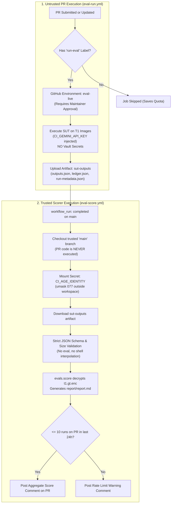

# Continuous Integration & Evaluation Security Architecture

This document describes the Continuous Integration (CI) infrastructure, security architecture, and maintainer operations for RecipeBoxer.

RecipeBoxer employs a strict **two-workflow split** to evaluate untrusted code from pull requests against live models and encrypted ground truth without risking secret leakage, answer-key exfiltration, or unauthorized API spend.

---

## 1. Architectural Overview & Security Principles



### Core Security Invariants
1. **Never use `pull_request_target` with PR code checkout**: Running untrusted pull request code with repository write permissions or secret access creates critical security vulnerabilities.
2. **Ground-Truth Secrecy (INV-AC1 / INV-AC5)**: The evaluation ground truth (`evals/vault/*.gt.enc`) is encrypted with `age`. Untrusted PR runs in `eval-run.yml` have **no access** to the decryption identity. Ground truth is decrypted strictly within `eval-score.yml`, which executes code solely from the trusted default branch (`main`).
3. **Black-Box SUT Execution**: The System Under Test (SUT) executes in an isolated subprocess with scrubbed environment variables and audit hooks that block file opens targeting eval corpora, ground truth, or vault files.
4. **Aggregate-Only Feedback Policy**: For benchmark tiers T1 through T4, scorers report aggregate and per-category metrics only. Per-item ground truth and individual recipe diffs are never exposed in CI comments or reports to prevent reverse-engineering the evaluation set.

---

## 2. Workflow Catalog

| Workflow | File | Trigger | Context & Permissions | Secrets | Description |
|---|---|---|---|---|---|
| **CI** | `.github/workflows/ci.yml` | `push`, `pull_request` | Untrusted PR / branch.<br>`contents: read` | **None** | Runs offline unit/integration test suite, anticheat static invariant checks, and frontend tests (vitest). |
| **Eval Run** | `.github/workflows/eval-run.yml` | `pull_request` (`run-eval` label), `push` (`main`), `workflow_dispatch` | Untrusted PR code.<br>Gated by `eval-live` environment.<br>`contents: read` | `CI_GEMINI_API_KEY` | Executes SUT against public Tier 1 images. Enforces `RB_EVAL_MAX_USD` budget cap. Publishes `sut-outputs` artifact. |
| **Eval Score** | `.github/workflows/eval-score.yml` | `workflow_run` (on completion of `eval-run`) | Trusted `main` branch only.<br>`contents: read`<br>`actions: read`<br>`pull-requests: write` | `CI_AGE_IDENTITY` | Downloads and validates `sut-outputs`. Mounts CI age key, decrypts `evals/vault/t1.gt.enc`, scores SUT predictions, and posts aggregate PR comment (rate-limited). |

---

## 3. Maintainer Setup Step-by-Step

Follow these steps when provisioning CI for a new repository instance or rotating secrets.

### Step 1: Generate the CI Age Identity Keypair
Maintainers must generate a dedicated `age` identity for GitHub Actions **outside the repository workspace** to prevent accidental git inclusion:

```bash
# In your terminal (Linux VM / macOS):
python -m evals.vault keygen --out /tmp/recipeboxer_ci_age.key
```

Output:
```text
Public key: age1ql3z7hjy54pw3hyww5ayyfg7zqgvc7w3j2elw8zmrj2kg5sfn9aqmcac8p
Identity key written to: /tmp/recipeboxer_ci_age.key (mode 600)
```

Verify permissions and inspect the generated identity:
```bash
cat /tmp/recipeboxer_ci_age.key
# Format: AGE-SECRET-KEY-1...
```

### Step 2: Add Public Key to Recipients & Rekey Vault
Add the public key from Step 1 to `evals/vault/recipients.txt` and re-encrypt the vault archives:

```bash
# Add recipient
python -m evals.vault add-recipient age1ql3z7hjy54pw3hyww5ayyfg7zqgvc7w3j2elw8zmrj2kg5sfn9aqmcac8p

# Rekey vault archives with your local maintainer key
python -m evals.vault rekey evals/vault
```

Commit the updated `evals/vault/recipients.txt` and `.enc` files:
```bash
git add evals/vault/recipients.txt evals/vault/*.gt.enc
git commit -m "chore(evals): add CI age public key to vault recipients"
```

### Step 3: Store Secret `CI_AGE_IDENTITY`
In GitHub repository settings:
1. Navigate to **Settings** > **Secrets and variables** > **Actions**.
2. Click **New repository secret**.
3. Name: `CI_AGE_IDENTITY`.
4. Secret: Paste the entire content of `/tmp/recipeboxer_ci_age.key` (including `AGE-SECRET-KEY-1...`).
5. Save the secret and securely delete the temporary key file:
   ```bash
   shred -u /tmp/recipeboxer_ci_age.key 2>/dev/null || rm -f /tmp/recipeboxer_ci_age.key
   ```

### Step 4: Create the `eval-live` GitHub Environment
The `eval-run.yml` workflow gates execution behind the `eval-live` environment to prevent arbitrary fork code from consuming Gemini API quotas:

1. Navigate to **Settings** > **Environments**.
2. Click **New environment** and enter name: `eval-live`.
3. Under **Deployment protection rules**:
   - Check **Required reviewers**.
   - Add authorized maintainers or team members who must approve live eval runs.
4. (Optional) Under **Deployment branches**, configure allowed branches (or allow all branches for PR gating).

### Step 5: Configure `CI_GEMINI_API_KEY` with Provider-Side Spend Caps
1. In Google AI Studio or Google Cloud Console, provision a **dedicated API key** named `recipeboxer-ci-live`.
2. **Set a Provider-Side Budget Cap**:
   - In Google Cloud Console billing, set a hard budget cap or quota restriction (e.g. $10.00/month maximum spend).
   - Configure billing alert emails to notify maintainers at 50%, 80%, and 100% consumption.
3. In GitHub repository settings:
   - Navigate to **Settings** > **Environments** > **eval-live** (or Repository Secrets).
   - Click **Add secret**.
   - Name: `CI_GEMINI_API_KEY`.
   - Secret: Paste the dedicated Gemini API key.
4. **Key Rotation Schedule**:
   - Rotate `CI_GEMINI_API_KEY` quarterly or immediately if an untrusted PR execution is suspected of leaking environment variables.

### Step 6: Create the `run-eval` Pull Request Label
1. In GitHub, navigate to **Pull requests** > **Labels**.
2. Click **New label**.
3. Name: `run-eval`.
4. Description: `Triggers live SUT evaluation run in CI (requires maintainer review)`.
5. Color: `#0E8A16` (green).

---

## 4. Contributor & Fork PR Evaluation Policy

| Contributor Action | Allowed Locally? | Evaluated in CI? | Conditions / Requirements |
|---|---|---|---|
| **Run Unit / Offline Tests** | Yes | Yes (in `ci.yml`) | Runs automatically on every push and PR. No secrets required. |
| **Inspect Tier 1 Images** | Yes | N/A | T1 images are public in `evals/corpora/t1/`. |
| **Run SUT on T1 Images Locally** | Yes | N/A | Contributor provides their own `GEMINI_API_KEY`. |
| **Score T1 Locally** | **No** | N/A | Ground truth (`evals/vault/t1.gt.enc`) is age-encrypted. Contributor does not have the private key. |
| **Run Official CI Eval on PR** | N/A | **Yes** (in `eval-run.yml` + `eval-score.yml`) | Requires: (1) Maintainer applies `run-eval` label; (2) Maintainer approves `eval-live` environment run. |
| **Score Tier 2 (Held-Out)** | **No** | **No on PRs** | T2 runs only on trusted refs (`main` / release tags) via `workflow_dispatch`. |

### Fork PR Review Workflow
1. An external contributor submits a pull request from a fork.
2. `ci.yml` runs immediately, verifying offline test suite, static invariants, and frontend tests.
3. A maintainer inspects the PR diff for malicious code, network exfiltration attempts, or prompt manipulation.
4. If the PR is ready for benchmarking, the maintainer applies the `run-eval` label.
5. GitHub Actions queues `eval-run.yml` and requests approval for the `eval-live` environment.
6. The maintainer approves the deployment in the GitHub Actions UI.
7. `eval-run.yml` executes the SUT within budget ($2.00 cap) and uploads `sut-outputs`.
8. `eval-score.yml` triggers on `main`, validates the artifact, decrypts ground truth, and posts an aggregate score comment on the PR.

### Rate Limiting Policy
To prevent adaptive leaderboard overfitting (submitting minor variants repeatedly to probe ground truth), `eval-score.yml` enforces:
- **Maximum 10 scored runs per PR per 24 hours** (`MAX_SCORED_RUNS_PER_24H`).
- When the cap is reached, `eval-score.yml` posts a notification comment and pauses scoring on that PR until the window resets.

---

## 5. Threat Model & Security Mitigations

| Threat | Attack Vector | Mitigation in Architecture |
|---|---|---|
| **Untrusted Code Execution with Secrets** | Attacker opens PR with malicious code attempting to read repo secrets. | Untrusted PR code runs only in `eval-run.yml` where `CI_AGE_IDENTITY` does **NOT** exist. `eval-score.yml` checks out trusted `main` branch only. Never use `pull_request_target`. |
| **Ground-Truth Exfiltration** | Attacker tries to read `evals/vault/*.gt.enc` during SUT execution. | 1. SUT subprocess runs with scrubbed environment and `sys.addaudithook` preventing reads of `evals/`, `*.gt.enc`, or keys.<br>2. SUT has no age identity key to decrypt the vault.<br>3. Decryption occurs only in `eval-score.yml` on `main`. |
| **Answer-Key Hardcoding / Cheating** | Contributor hardcodes known recipe titles, hashes, or filenames into code. | Anti-cheat invariant tests (`tests/anticheat/test_static_invariants.py`) reject static filename patterns, answer keys, or corpus hashes. Scorer uses Hungarian matching and opaque image IDs. |
| **Gemini API Quota / Spend Exhaustion** | Malicious PR loops API calls to exhaust developer credits. | 1. `eval-live` environment requires human maintainer approval before key is exposed.<br>2. `RB_EVAL_MAX_USD` limits spend per run.<br>3. Provider-side budget cap enforces hard monthly ceiling.<br>4. PR label requirement (`run-eval`) prevents automatic execution on fork pushes. |
| **SUT Output Artifact Poisoning** | Malicious PR crafts oversized JSON or shell injection in artifact filenames. | `eval-score.yml` validates file sizes (max 25MB), verifies schemas via `json.load()` (no `eval`), and regex-checks all IDs (`^[a-zA-Z0-9_.-]+$`). |
| **PR Number / Head SHA Spoofing** | Attacker attempts to post scores to another PR or impersonate a commit. | `eval-score.yml` cross-checks `run-metadata.json` against `github.event.workflow_run.pull_requests` and `workflow_run.head_sha`. |
| **Adaptive Overfitting to Eval Set** | Contributor iteratively probes test cards to maximize score. | 1. T1 metrics are aggregate + per-category only (never per-item diffs).<br>2. Rate limit of ≤ 10 scored runs per PR per 24 hours.<br>3. Milestone decisions require Tier 2 held-out benchmarks. |

---

## 6. Oracle Grouping Track & Future Held-Out Benchmarks

### The Oracle Grouping Track
To isolate recipe extraction quality from clustering/grouping errors, RecipeBoxer supports an **oracle grouping track**:
- The trusted scorer generates an oracle plan:
  ```bash
  python -m evals.score oracle-plan --tier T1 --out plan.json
  ```
  The oracle plan groups image IDs into true recipe sets, with sets presented in random order and card faces shuffled. It contains no recipe text or titles.
- When maintainers trigger an oracle evaluation, they provide `oracle_plan: "path/to/plan.json"` via `workflow_dispatch` in `eval-run.yml`.
- The runner passes `--oracle-plan plan.json` to `evals.harness.run`.

### Future Tier 2 Held-Out Benchmark (`eval-heldout.yml`)
Tier 2 (held-out) benchmark datasets prevent overfitting to Tier 1:
- **T2 Images & GT**: Stored encrypted in the vault (`evals/vault/t2.images.tar.enc` and `evals/vault/t2.gt.enc`). Never committed in plaintext.
- **Trigger**: Run exclusively by maintainers on trusted refs (`refs/heads/main` or release tags) via `workflow_dispatch` at project milestones (Gate A and Gate B).
- **Execution Flow**:
  1. Checks out trusted ref.
  2. Mounts `CI_AGE_IDENTITY`.
  3. Decrypts `t2.images.tar.enc` into a private runner temporary directory outside workspace.
  4. Executes SUT on decrypted images.
  5. Decrypts `t2.gt.enc` and computes aggregate benchmark scores.
  6. Securely shreds decrypted images and age keys upon completion.
  7. Publishes benchmark artifact and logs results to release notes.
