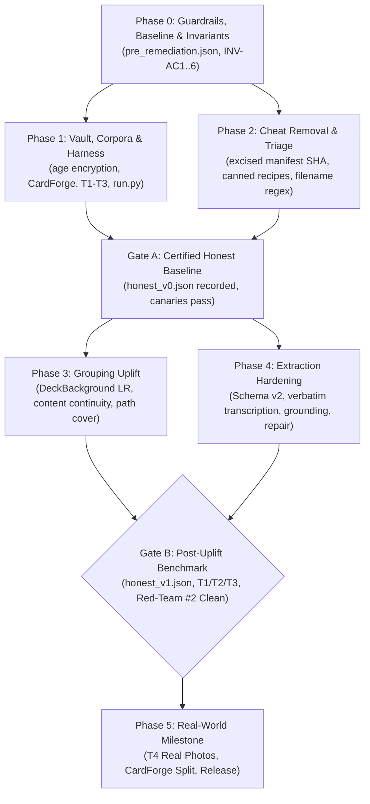

# RecipeBoxer Strategic Roadmap & Milestone Tracking

This document tracks the current status of the RecipeBoxer codebase following the eval-cheat remediation, completed milestones, and prioritized remaining work leading up to **Gate B** and beyond.

---

## 1. Remediation Status Overview

The RecipeBoxer codebase has completed Phases 0 through 4 of the comprehensive eval-cheat remediation ([`_agents/remediation/REMEDIATION_PLAN.md`](file:///storage/emulated/10/AntiGravity/Workspaces/recipeboxer/_agents/remediation/REMEDIATION_PLAN.md)):

### Milestone Progress Summary
- `[x]` **Phase 0 (Guardrails & Invariants)**: Established non-negotiable invariants INV-AC1..INV-AC6 in [`_agents/INVARIANTS.md`](file:///storage/emulated/10/AntiGravity/Workspaces/recipeboxer/_agents/INVARIANTS.md), recorded contaminated baseline [`pre_remediation.json`](file:///storage/emulated/10/AntiGravity/Workspaces/recipeboxer/evals/baselines/pre_remediation.json), created test remediation catalog [`evals/triage.yaml`](file:///storage/emulated/10/AntiGravity/Workspaces/recipeboxer/evals/triage.yaml), and measured live token pricing.
- `[x]` **Phase 1 (Vault, Corpora & Harness)**: Built multi-recipient `age` ground-truth vault ([`evals/vault.py`](file:///storage/emulated/10/AntiGravity/Workspaces/recipeboxer/evals/vault.py)), isolated synthetic card generator ([`cardforge/`](file:///storage/emulated/10/AntiGravity/Workspaces/recipeboxer/cardforge/)), curated public-domain real-web archive Tier T3, implemented black-box runner with runtime audit hooks ([`evals/harness/run.py`](file:///storage/emulated/10/AntiGravity/Workspaces/recipeboxer/evals/harness/run.py)), and authored secure CI workflows ([`docs/CI.md`](file:///storage/emulated/10/AntiGravity/Workspaces/recipeboxer/docs/CI.md)).
- `[x]` **Phase 2 (Cheat Removal & Test Triage)**: Excised all manifest SHA tables, canned recipe fallbacks, and filename heuristics from `recipeboxer/`. Implemented typed `StageFailure` models. Triage-resolved over 45 contaminated tests.
- `[x]` **Gate A (Certified Honest Baseline)**: Anti-cheat canaries green. Recorded first certified honest baseline ([`evals/baselines/honest_v0.json`](file:///storage/emulated/10/AntiGravity/Workspaces/recipeboxer/evals/baselines/honest_v0.json)) on pre-uplift code across T1 and T3.
- `[x]` **Phase 3 (Grouping Uplift)**: Implemented collection-relative likelihood ratio weighting (`DeckBackground`), content continuity analysis (`recipeboxer/correlation/content.py`), set-level LLM verification with quote extraction (`SetVerifier`), isotonic calibration (`LinkCalibrator`), and global path cover optimization (`path_cover`).
- `[x]` **Phase 4 (Extraction Hardening & Schema v2)**: Built 7-stage extraction pipeline (`prepare` $\rightarrow$ `transcribe` $\rightarrow$ `structure` $\rightarrow$ `repair` $\rightarrow$ `ground` $\rightarrow$ `normalize` $\rightarrow$ `consistency`), updated 9 exporters to Schema v2, implemented frontend legibility indicators and spend cap controls.
- `[x]` **Red-Team #2 Verification & Remediation**: Completed comprehensive audit ([`_agents/remediation/REDTEAM-2.md`](file:///storage/emulated/10/AntiGravity/Workspaces/recipeboxer/_agents/remediation/REDTEAM-2.md)) and fixes (`WP-RT2a`, `WP-RT2b`): eliminated all mock-sniffing and legacy httpx paths, cached physical pairing calculations (>50x speedup), sanitized prompt templates, and hardened quote validation.

---

## 2. Active Priorities: Gate B Certification

The immediate milestone is **Gate B** sign-off:

### 2.1 Gate B Benchmark Run (`honest_v1.json`)
- **Objective**: Execute the fully integrated, post-uplift pipeline (`GroupingEngine` + `ExtractionPipeline`) black-box against T1 (dev-eval), T2 (held-out), and T3 (real-web).
- **Success Criteria**:
  1. **T2 Held-Out**: Statistically beat `honest_v0` on B-Cubed F1, Exact Cluster Accuracy, and Order Kendall $\tau$.
  2. **T3 Real-Web**: Lower false-merge rate on real distractor cards while improving ingredient and direction extraction F1.
  3. **Homogeneous Decks**: Grouping F1 on homogeneous decks must not degrade significantly compared to mixed decks.
  4. **Naming Invariance**: Benchmark scores agree within noise across `opaque`, `misleading`, `shuffle`, and `reencode` variants.
  5. **Red-Team Certified**: Zero audit hook trips, zero prompt leaks, zero static AST invariant failures.
- **Concurrent Enablers**:
  - `WP-SV`: Scorer enhancements, tie-handling normalization, hierarchical reporting.
  - `WP-M1`: Model default updates in `recipeboxer/config.py` aligned with verified rates in `recipeboxer/data/pricing.toml`.

---

## 3. Prioritized Strategic Roadmap

| Priority | Track | Item | Description | Target Milestone |
|:---:|---|---|---|:---:|
| **P1** | **Certification** | **Gate B Benchmark** | Full benchmark across T1, T2, T3; commit `honest_v1.json`. | Gate B |
| **P1** | **Operations** | **CI Secrets Setup** | Configure `CI_AGE_IDENTITY` and `CI_GEMINI_API_KEY` in GitHub repository secrets and `eval-live` environment. | Gate B |
| **P2** | **Evaluation** | **d04 Baseline Gap Closure** | Evaluate the 319-card homogeneous deck `d04` with the new $O(N \cdot k)$ pipeline (omitted in `honest_v0` due to legacy $O(N^2)$ scaling). | Gate B / `honest_v1` |
| **P2** | **Real-World** | **Tier T4 Real Photo Intake** | Ingest and benchmark real smartphone photos of family recipe cards via `evals/intake_real.py`. | Phase 5 |
| **P3** | **Architecture** | **CardForge Repository Split** | Split `cardforge/` out of the mono-repo into its own independent repository (`cardforge/cardforge`) per Decision D8. | Post-Gate B |
| **P3** | **Vision / ML** | **Outline-Feature Real Data Validation** | Validate `outline_match_score` (silhouette and corner matching) on real photographed cards with varying lighting and backgrounds. | Post-Gate B |
| **P3** | **Vision / OCR** | **Optional OCR Keep/Kill Decision** | Evaluate Gate B homogeneous ablations to decide whether RapidOCR should remain an optional plugin or be removed. | Post-Gate B |
| **P4** | **Test Hygiene** | **Resolve 13 Pre-Existing Test Failures** | Remediate 6 Windows-path escaping assertions in archive tests and 7 headless Tkinter GUI dialog tests. | Post-Gate B |

---

## 4. Deep-Dive on Specific Roadmap Items

### 4.1 Tier T4 Real Photo Benchmark (Family Collections)
- **Status**: Intake script completed ([`evals/intake_real.py`](file:///storage/emulated/10/AntiGravity/Workspaces/recipeboxer/evals/intake_real.py)); documentation authored ([`evals/INTAKE.md`](file:///storage/emulated/10/AntiGravity/Workspaces/recipeboxer/evals/INTAKE.md)).
- **Action**: When the maintainer provides 10–20 photographed recipe cards (including $\ge 5$ multi-card sets), run intake with GPS stripping, encrypt into `evals/vault/t4.gt.enc`, and record the definitive real-world benchmark score.
- **Privacy Policy**: Uses a dedicated paid Gemini API key with hard spend caps in Google AI Studio to ensure family photos are not utilized for model training.

### 4.2 The `d04` Scale & Homogeneity Baseline Gap
- **Background**: In `honest_v0.json`, the 319-card homogeneous deck `d04` was excluded because the pre-uplift code performed pairwise $O(N^2)$ LLM verification, which would have required over 50,000 API calls and exceeded practical budget limits.
- **Resolution**: Wave 5 implemented $O(N \cdot k)$ top-k screening (`recipeboxer/correlation/screening.py`) and single-call candidate set verification (`SetVerifier`).
- **Plan**: `d04` will be evaluated for the first time in `honest_v1.json`, validating grouping scaling, latency, and accuracy on large homogeneous card collections.

### 4.3 Optional Complementary Local OCR (Keep/Kill Decision)
- **Background**: Evaluated in spike `WP-O1` (`_agents/remediation/WP-O1.md`). RapidOCR was tested across all 48 Tier T0 cards.
- **Findings**:
  - Achieved **1.000 precision** on boundary continuation cues (`"over"`, `"PTO"`, `"cont'd"`).
  - High character error rate on cursive script (CER 0.64), confirming OCR cannot replace LLM transcription (INV-AC6).
  - Added **~161 MB uncompressed dependencies** (`onnxruntime`, `opencv-python`), doubling the PyInstaller binary download size, and added ~2.0s CPU inference latency per card.
- **Recommendation**: Deferred as an optional plugin (`pip install "recipeboxer[ocr]"`).
- **Keep/Kill Rule**: A formal decision will occur after Gate B ablations. If feature toggling proves OCR cues measurably improve top-k screening on real collections without degrading user experience, retain as an optional plugin; otherwise, excise entirely to minimize dependency bloat.

### 4.4 Outline-Feature Validation on Real Data
- **Background**: `outline_match_score` in `recipeboxer/vision/physical_pairing.py` calculates card contour and aspect ratio similarity to identify physical card pairs.
- **Gap**: While verified on synthetically degraded CardForge cards with known ground-truth cut parameters, real phone photographs introduce perspective skew, shadows, and varying background surfaces (cutting boards, countertops).
- **Plan**: Benchmark contour extraction on Tier T3 and Tier T4 images using adaptive background segmentation before assigning high likelihood-ratio weights.

### 4.5 CardForge Independent Repository Split (Decision D8)
- **Background**: Synthetic card generation templates originally resided in `recipeboxer/tools/card_generator.py`, leaking ground-truth recipe text into the shipped application package.
- **Progress**: Decoupled in WP-V2 into top-level directory [`cardforge/`](file:///storage/emulated/10/AntiGravity/Workspaces/recipeboxer/cardforge/) with independent `pyproject.toml` and tests. Static invariants guarantee `recipeboxer` never imports `cardforge`.
- **Plan**: Extract `cardforge` into its own standalone Git repository (`recipeboxer/cardforge`) with independent packaging and distribution. `evals/` will consume CardForge via standard package dependency.

### 4.6 Maintainer CI Secrets Provisioning
Before automated PR scoring can operate in GitHub Actions ([`docs/CI.md`](file:///storage/emulated/10/AntiGravity/Workspaces/recipeboxer/docs/CI.md)), maintainers must configure:
1. `CI_AGE_IDENTITY`: Private age identity generated via `python -m evals.vault keygen`, added to `evals/vault/recipients.txt`, and saved as a repository secret for `eval-score.yml`.
2. `CI_GEMINI_API_KEY`: Dedicated Google AI Studio API key with a hard billing spend cap (\$10–\$20/month) assigned to the `eval-live` GitHub environment for maintainer-gated PR evaluation runs.

### 4.7 Remediation of 13 Pre-Existing Test Failures
Across the 2,270+ test suite, exactly 13 tests currently fail due to known out-of-scope platform assumptions:
- **6 Windows-Path ZipSlip Tests (`tests/test_archive_empirical_challenger.py`)**: Assert Windows backslash path escaping behavior (`..\\..\\evil.txt`) which is evaluated differently under Linux POSIX path semantics.
  - *Fix*: Normalize path separator handling in test assertions to be cross-platform agnostic.
- **7 Headless Tkinter GUI Dialog Tests (`tests/test_browse_directory.py`)**: Attempt to instantiate `tkinter.filedialog` in a headless Linux environment without an active `DISPLAY` or X11 server.
  - *Fix*: Mock `askdirectory()` when running in non-interactive / headless CI environments.
