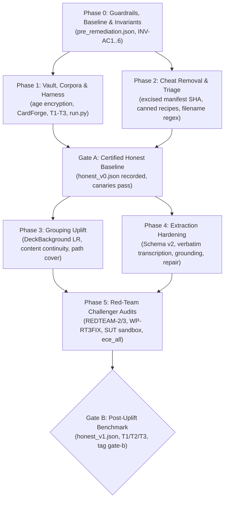

# RecipeBoxer Strategic Roadmap & Milestone Tracking

This document serves as the single canonical roadmap and prioritized backlog for **RecipeBoxer**. It tracks completed product milestones (M1–M16), the eval-cheat remediation lifecycle (Gate A & Gate B), remaining prioritized engineering work, deferred maintainer operations, and items waiting on user input.

---

## Roadmap Status Conventions

All roadmap items and milestones use standardized status tags:

- `[x] Completed`: Fully implemented, verified against testing suites, and integrated with zero regressions.
- `[~] In Progress`: Active milestone or feature currently under active implementation or review.
- `[ ] Planned`: Approved future enhancement in the prioritized backlog.

---

## 1. Completed Milestones

### 1.1 Product Milestones (M1–M16)

The following table summarizes the foundational product milestones. Where an original claim was superseded or identified as an evaluation cheat during the October 2026 audit, a **Superseded:** note is preserved for historical accuracy.

| Milestone | Title | Key Deliverables & Historical Record | Status |
|:---:|---|---|:---:|
| **M1** | **Backend Architecture & Core Domain Engine** | Python package structure, Pydantic V2 models (`VisualFingerprint`, `RecipeSchema`), CIELAB $\Delta E$ color math, scan proximity decay, horizontally mirrored stain bleed-through, ruling/ink heuristics, greedy bipartite matching optimizer.<br>*Superseded:* Model defaults upgraded from Gemini 3.7/2.5 to `gemini-3.8-flash` / `gemini-3.1-pro`. Greedy bipartite matching superseded by global `path_cover` DAG correlation with `DeckBackground` likelihood ratios. Filename-based ink/ruling heuristics removed (INV-AC2). | `[x] Completed` |
| **M2** | **FastAPI REST & SQLite WAL Persistence** | FastAPI ASGI application, thread-safe `FingerprintCache` (SHA-256 cache), relational `SessionStore` (sessions, cards, proposals, recipes), secure card image streaming, multipart uploads, CLI runner. | `[x] Completed` |
| **M3** | **Real-Time SSE & HITL Review Pipeline** | Server-Sent Events stream (`/api/events`), cooperative async barrier (`approval_event` & `cancellation_event`), Rapid Review Queue, Candidate Drawer ranking, 3+ card multi-part recipe grouping trays, global hotkey shortcuts. | `[x] Completed` |
| **M4** | **Multi-Format Exporters & Schema.org JSON-LD** | Plan To Eat RFC 4180 9-column CSV serializer with CRLF terminators, Schema.org Recipe JSON-LD exporter (`HowToStep`, `@graph`, ISO 8601 duration parser), standard JSON serializer, and download endpoints.<br>*Superseded:* All serializers updated to Schema v2 during Phase 4 remediation. | `[x] Completed` |
| **M5** | **React 18+ TypeScript SPA & Static Embedding** | React 18 SPA with Vite, Tailwind CSS, Lucide icons, custom hooks (`useSSE`, `useKeyboard`, `useImageViewer`, `useRecipeForm`, `useTheme`), interactive pan/zoom/filter card viewer, Vite build contract directly into `recipeboxer/api/static`, SPA catch-all fallback with `/api` 404 guard. | `[x] Completed` |
| **M6** | **Agent Guidance, Invariants & Repository Structure** | Complete `_agents/` documentation directory (`README.md`, `ARCHITECTURE.md`, `INVARIANTS.md`, `TESTING_GUIDELINES.md`, `EXTENDING_RECIPEBOXER.md`), 4-tier testing guide, extension playbooks, and standardized roadmap persistence conventions.<br>*Superseded:* Invariants expanded with non-negotiable Anti-Cheat invariants (INV-AC1..INV-AC6). | `[x] Completed` |
| **M7** | **License Compliance & Dependency Vetting Audit** | Full automated audit of 60+ Python and 17+ npm dependencies confirming 100% GPLv3 compatibility; formalized Invariant 8 in `_agents/INVARIANTS.md`. | `[x] Completed` |
| **M8** | **Sample Card Corpus, Provenance & Synthetic Generator** | 48 high-resolution historical card fixtures across 6 modalities (24 recipes), CC0/public domain provenance guide (`tests/fixtures/sample_cards/README.md`), strict Pydantic `manifest.json`, procedural generator tool (`recipeboxer/tools/card_generator.py`), and pytest loader fixtures.<br>*Superseded:* Initial corpus was 100% synthetic (contrary to early provenance claims) and contained answer keys. Demoted to Tier T0 (train/fixture only). `manifest.json` SHA lookups excised (INV-AC1/AC3). Generator extracted to standalone `cardforge/` package (Decision D8). | `[x] Completed` |
| **M9** | **Agent & Prompt Evaluation Harness & Benchmark Suite** | Quantitative metric suite (Pairing F1, Levenshtein CER/WER, Plan To Eat / Schema.org schema conformity), LLM-as-a-Judge semantic rubric evaluator (`recipeboxer/evals/judge.py`), golden dataset benchmark runner CLI (`evals/run_benchmarks.py`), and 65 unit/integration tests.<br>*Superseded:* Legacy eval harness allowed manifest hash lookups, filename heuristics, and offline mock judge (returning 4.96/5.0). Completely replaced by black-box isolated subprocess runner (`evals.harness.run`), audit hooks (`sut_boot.py`), age-encrypted vault, and Hungarian scorer (`evals.score`). Test counts predate honest harness. | `[x] Completed` |
| **M10** | **Adaptive Vision Prompts, Antigravity Skills & CV Tools** | Deterministic CV preprocessing (coarse-to-fine projection deskewing $\pm 1^\circ$, border cropping, CLAHE contrast enhancement, CIE $L^*a^*b^*$ clustering), Antigravity domain skills (`vintage-handwriting-ocr`, `print-clipping-extractor`), modality classifier (95.7% accuracy), and dynamic thinking budget allocation.<br>*Superseded:* Router manifest SHA lookups excised; router and prompt branches re-grounded on genuine visual features. | `[x] Completed` |
| **M11** | **Archival Document Generation & Extended Exporters** | Google Docs batch update archival exporter with card scan embedding, offline OpenXML DOCX & printable PDF cookbook generators, Obsidian Markdown with YAML frontmatter, Cooklang (`.cook`), Paprika (`.paprikarecipes`), FastAPI export endpoints, and React frontend export UI integration. | `[x] Completed` |
| **M12** | **Cloud & External Source Providers** | Unified `BaseSourceProvider` abstraction, Google Photos Library API connector with OAuth2 auto-refresh & album filtering, Google Drive folder selector, S3/GCS bucket connectors, REST source management endpoints, and React album picker UI. | `[x] Completed` |
| **M13** | **Interactive UI Guided Tour, User Guide & MVP Packaging** | Accessible 6-step interactive onboarding tutorial overlay (`frontend/src/components/tutorial/`), complete multi-platform documentation and architecture walkthrough (`README.md`), CLI option verification (`--concurrency`), and standalone PyInstaller packaging verification. | `[x] Completed` |
| **M14** | **Open-Ended N-Part Sequence Correlation & Model Modernization** | Clean-break deprecation of `front_card_id`/`back_card_id` across models and schemas; directed transition graph and DAG maximal path chaining ($N \ge 1$); dynamic SQLite `session_proposals` sequence migration; unified "Part 1 of N" HITL UI with drag-and-drop reordering, split, and merge; sequence-preserving multimodal extraction and 9 exporters; 1,660 passing tests.<br>*Superseded:* Directed transition graph upgraded during remediation to `DeckBackground` collection likelihood ratios, candidate ranking, and global `path_cover`. Test counts predate honest test triage. | `[x] Completed` |
| **M15** | **Integration Findings Resolution & Eval Anti-Cheating Hardening** | Dynamic OS-adaptive folder import path placeholders (`C:\...`, `/Users/...`, `/home/...`), evaluation filename and metadata obfuscation/sanitization (`obfuscation.py`, `runner.py`) preventing LLM cheating, authentic public domain magazine/box/can label clippings added to corpus, and interactive Google Identity Services (GIS) OAuth popup authorization for Docs export and Drive/Photos ingestion; 1,592 pytest + 290 vitest tests passing.<br>*Superseded:* Obfuscation layer in M15 was audited in 2026-10 and found vulnerable (original SHA survived obfuscation, in-memory de-obfuscation registry, offline mock judge, canned fallbacks). Replaced by cryptographic vault and black-box subprocess sandbox. | `[x] Completed` |
| **M16** | **Multi-Session Project Persistence & Export Curation** | Portable `.recipeboxer` ZIP archive format with content-addressed SHA-256 asset storage, project save/import/merge REST endpoints, incremental duplicate-skipping ingestion engine, 5 export curation grouping presets (Course, Contributor, Tag, Alphabetical, Custom) with manual drag-and-drop reordering, styled section divider pages and TOCs across DOCX, PDF, and Google Docs; 1,848 pytest + 357 vitest tests passing.<br>*Superseded:* Test counts predate the 2026-10 honest evaluation triage. | `[x] Completed` |

---

### 1.2 Eval-Cheat Remediation (2026-10)

Following an internal audit that uncovered answer-key lookups, filename heuristics, and canned fallbacks, the codebase underwent a comprehensive 7-phase remediation ([`_agents/remediation/REMEDIATION_PLAN.md`](../_agents/remediation/REMEDIATION_PLAN.md)):



- `[x]` **Phase 0 (Guardrails, Baseline & Invariants)**: Formalized non-negotiable anti-cheat invariants INV-AC1..INV-AC6 in [`_agents/INVARIANTS.md`](../_agents/INVARIANTS.md), recorded contaminated baseline [`evals/baselines/pre_remediation.json`](../evals/baselines/pre_remediation.json), created test triage catalog `evals/triage.yaml`, and calibrated live token pricing.
- `[x]` **Phase 1 (Vault, Corpora & Harness)**: Implemented multi-recipient `age` ground-truth vault (`evals/vault.py`), isolated synthetic card generator into standalone [`cardforge/`](../cardforge/), curated public-domain real-web archive Tier T3, built black-box runner with runtime audit hooks (`evals/harness/run.py`, `sut_boot.py`), and authored secure CI architecture ([`docs/CI.md`](CI.md)).
- `[x]` **Phase 2 (Cheat Removal & Test Triage)**: Excised all manifest SHA tables, canned recipe fallbacks, and filename heuristics from `recipeboxer/`. Added typed `StageFailure` models. Triaged over 45 contaminated tests.
- `[x]` **Gate A (Certified Honest Baseline)**: Anti-cheat canaries green. Certified honest baseline recorded in [`evals/baselines/honest_v0.json`](../evals/baselines/honest_v0.json) on pre-uplift code across T1 (d01–d03) and T3 on 2026-10-15.
- `[x]` **Phase 3 (Grouping Uplift)**: Implemented collection-relative likelihood ratio weighting (`DeckBackground`), content continuity analysis (`recipeboxer/correlation/content.py`), set-level LLM verification with quote extraction (`SetVerifier`), isotonic calibration (`LinkCalibrator`), and global path cover optimization (`path_cover`).
- `[x]` **Phase 4 (Extraction Hardening & Schema v2)**: Built 7-stage extraction pipeline (`prepare` $\rightarrow$ `transcribe` $\rightarrow$ `structure` $\rightarrow$ `repair` $\rightarrow$ `ground` $\rightarrow$ `normalize` $\rightarrow$ `consistency`), updated 9 exporters to Schema v2, and added frontend legibility indicators and spend cap controls.
- `[x]` **Phase 5 (Red-Team Challenger Audits & Hardening)**: Completed audits #2 and #3 ([`_agents/remediation/REDTEAM-2.md`](../_agents/remediation/REDTEAM-2.md), [`_agents/remediation/REDTEAM-3.md`](../_agents/remediation/REDTEAM-3.md), [`_agents/remediation/WP-RT3FIX.md`](../_agents/remediation/WP-RT3FIX.md)). Enforced SUT sandbox isolation (`prepare_sut_sandbox` with private `HOME`, temp dirs, and strict allowlists), honest ECE evaluation (`ece_all` counting unmatched predictions), eliminated hardcoded fallback confidences, and killed 100% of mutation canaries.
- `[x]` **Phase 6 / Gate B Certification (`gate-b`, `honest_v1.json`)**: Passed 2026-10-15 and tagged `gate-b`. Certified post-uplift baseline across held-out Tier T2 (B-Cubed F1 `0.9210`, Kendall $\tau = 1.0000$), large homogeneous deck `d04` (319 cards in $O(N \cdot k)$ with 1,086 calls and zero false merges), and real-web Tier T3 (antique set, archived as T3A on 2026-10-16). See [`docs/EVALS.md`](EVALS.md) for full metrics.

---

## 2. Gate B Certification & Done Criteria

**Gate B** marked the completion of the post-uplift evaluation and pipeline hardening phase. All four non-negotiable Gate B done criteria were certified:

1. **T2 Held-Out Generalization**: The remediated pipeline statistically outperforms `honest_v0` across grouping and extraction on the uninspected, held-out Tier T2 (B-Cubed F1 `0.9210` vs `0.8040` on Gate A T1; exact cluster accuracy `0.8278` vs `0.4722`; Kendall $\tau = 1.0000$).
2. **d04 Homogeneous Scaling**: The 319-card homogeneous deck `d04` (omitted from Gate A due to $O(N^2)$ verification scaling requiring $>50,000$ calls) executed cleanly in $O(N \cdot k)$ with 1,086 calls and $8.34 total spend, achieving B-Cubed F1 `0.8264` and zero false merges.
3. **Red-Team Challenger #3 Clean**: Comprehensive adversarial challenger audit confirmed zero eval cheats, strict SUT sandbox isolation (`prepare_sut_sandbox` with private `HOME` and filesystem read allowlist), honest ECE evaluation (`ece_all` counting unmatched predictions), elimination of hardcoded confidence fallbacks, and 100% of mutation canaries killed.
4. **Baseline Committed**: Certified post-uplift baseline [`evals/baselines/honest_v1.json`](../evals/baselines/honest_v1.json) and encrypted outputs archive `honest_v1_outputs.tar.gz.enc` recorded.

---

## 3. Prioritized Remaining Work

The following backlog tracks remaining engineering work across quality, extraction, test hygiene, architecture, and cloud integration.

| Priority | Track | Item | Description | Target Milestone |
|:---:|---|---|---|:---:|
| **P1** | **Quality** | **d04 Same-Stock False Split Reduction** | Lower false-split rate on large homogeneous decks (`d04` false split `0.5664` where SetVerifier rejects true back $\rightarrow$ next-front links). | Sprint 1 |
| **P1** | **Evals** | **Modern T3 (1900s+): curate + GT-draft, then run** | Import the separately gathered modern real-world set into T3, draft structured GT text-only (`evals/curation_t3/`), memorization-probe and spot-check it; run the harness/scorer on T3 **when API quota allows**. Until then T3 reports "pending curation". | Sprint 1 |
| **P2** | **Reliability** | **`INVALID_RESPONSE` Resiliency** | Handle rare model empty/whitespace responses (`INVALID_RESPONSE`) that survive the WP-UP4 retries. | Sprint 2 |
| **P4** | **Extraction (optional)** | **Antique manuscript handling (archived T3A)** | Optional low-priority use case: title CER / paleography / calibration on 17th-century manuscripts (T3A title CER `0.4840` matched / `0.5665` e2e, `ece_all` `0.2844`). Out of product scope (1900s+). | Backlog |
| **P2** | **Test Hygiene** | **Platform & Environmental Test Failures** | Resolve 14 known test failures (6 Windows zip-slip tests, 7 headless Tkinter tests, 1 environmental setup script test). | Sprint 2 |
| **P3** | **Architecture** | **CardForge Standalone Repository Split** | Split `cardforge/` out of the mono-repo into its own independent repository (`recipeboxer/cardforge`) per Decision D8. | Sprint 3 |
| **P3** | **Cloud Integration** | **Official Google Cloud OAuth Provisioning & Fallback Deprecation** | Provision official GCP project with OAuth 2.0 Web Client for Docs/Drive scopes, embed public Client ID, and deprecate manual token entry drawer. | Sprint 3 |

---

### 3.1 Deep-Dive on Active Engineering Items

#### 3.1.1 The `d04` Same-Stock False Split Problem (Top Quality Item)
- **Background**: In `honest_v1.json`, the 319-card homogeneous deck `d04` successfully ran in $O(N \cdot k)$ with zero false merges, but exhibited a high **0.5664 false split rate**.
- **Root Cause**: Error analysis indicates that true multi-card links *were* offered to `SetVerifier` by the ranking stage, but were **rejected by the LLM**. This occurs predominantly on back $\rightarrow$ next-card-front transitions on identical paper stock, where the model judges that the title-less back "already looks complete" or mistakenly concludes that the next front card belongs to an independent recipe.
- **Action Plan**:
  - Investigate prompt and context engineering in `recipeboxer/prompts/set_verify_v2.md` to provide semantic continuity cues (e.g. ingredient list continuity, step number continuation) rather than relying solely on visual/lexical similarity.
  - Experiment with continuity score biasing in `recipeboxer/correlation/engine.py` for extension anchors without triggering false merges.

#### 3.1.2 Modern T3 Set & `INVALID_RESPONSE` (antique set archived as T3A)
- **Re-scope (WP-T3A, 2026-10-16)**: the product targets recipes from the **1900s onward**. The antique 17th-century manuscript corpus (Folger/Wellcome) was deactivated and moved to the archived opt-in tier **T3A** (`evals/corpora/archive/t3_antique/`, `evals/vault/archive/t3a.gt.enc`). T3 is now "real-world modern (1900s+), pending curation".
- **Next steps (T3)**: (1) import the modern set gathered separately (orchestrator; see `evals/INTAKE.md` §T3); (2) draft structured GT text-only with `evals/curation_t3/draft_structured.py`, run `memorization_probe.py` and a `spotcheck.py` review; (3) run harness + scorer on T3 when API quota allows. No live runs until then.
- **Historical numbers below refer to T3A** (the `honest_v0`/`honest_v1` "T3" columns). Antique handling is kept only as an optional low-priority use case (P4):
  - Title CER remains high (`0.4840` matched / `0.5665` end-to-end) due to archaic orthography, idiosyncratic headings, and dense multi-recipe manuscript pages.
  - Direction F1 (`0.5102` e2e) and Ingredient F1 (`0.6279` e2e) lag behind modern card decks.
- **Occasional `INVALID_RESPONSE`**: T3 recorded one stage failure (`n_stage_failures = 1`) due to Gemini returning an empty or whitespace-only response on an unreadable archival image. While WP-UP4 introduced client-level (`MIN_ATTEMPTS_ON_EMPTY = 2`) and stage-level (`generate_with_empty_retry`) retries, persistent empty responses still raise `INVALID_RESPONSE`.
- **Action Plan**: `INVALID_RESPONSE` fallback handling stays on the backlog (P2). Manuscript paleography prompt tuning is optional/low priority (P4, T3A only).

#### 3.1.3 Archived T3A Recipe Calibration (ECE 0.28) — optional, low priority
- **ECE Under-Calibration**: On the antique set (then "T3", now T3A), `ece_all` is `0.2844` (`ece_matched` is `0.3386`), with mean predicted confidence (`0.1539`) significantly under-rating actual extraction accuracy (`0.2800`). The recipe-confidence model (fitted on modern CardForge synthetic decks) lacks calibration for out-of-distribution archival layouts.
- **Action Plan**: No action planned (out of product scope). Recipe calibration will be re-assessed on the modern T3 set once it has been run.

#### 3.1.4 Remediation of Known Platform & Environmental Test Failures
Across the automated test suite, exactly 14 tests fail due to environmental and platform-specific assumptions:
- **6 Windows-Path ZipSlip Tests (`tests/test_archive_empirical_challenger.py`)**: Assert Windows backslash path escaping behavior (`..\\..\\evil.txt`) which is evaluated differently under Linux POSIX path semantics.
  - *Fix*: Normalize path separator handling in test assertions to be cross-platform agnostic.
- **7 Headless Tkinter GUI Dialog Tests (`tests/test_browse_directory.py`)**: Attempt to instantiate `tkinter.filedialog` in a headless Linux environment without an active `DISPLAY` or X11 server.
  - *Fix*: Mock `askdirectory()` when running in non-interactive / headless CI environments.
- **1 Environmental Setup Script Test (`test_scripts::test_setup_sh_fails_when_no_compatible_python`)**: Fails due to local Python virtual environment path discovery rather than `setup.sh` logic (`setup.sh` is untouched).
  - *Fix*: Decouple interpreter discovery from active virtualenv path in script test fixture.

#### 3.1.5 CardForge Independent Repository Split (Decision D8)
- **Background**: Decoupled in WP-V2 into top-level directory [`cardforge/`](../cardforge/) with independent `pyproject.toml` and tests. Static invariants guarantee `recipeboxer` never imports `cardforge`.
- **Plan**: Extract `cardforge` into its own standalone Git repository (`recipeboxer/cardforge`) with independent packaging and distribution. `evals/` will consume CardForge via standard package dependency.

#### 3.1.6 Official Google Cloud OAuth Provisioning & Fallback Deprecation (Phase 10)
- **Official Google Cloud Project Setup**: Provision a dedicated, zero-cost Google Cloud project for RecipeBoxer. Enable Google Docs API and Google Drive API (`drive.file` and `documents` scopes).
- **OAuth 2.0 Web Client Configuration**: Register an OAuth 2.0 Client ID with authorized JavaScript origins for local development (`http://localhost:8000`, `http://127.0.0.1:8000`). Submit OAuth consent screen for verification.
- **Repository Configuration**: Embed the official public Client ID into `frontend/.env.production` and default client configuration (`VITE_GOOGLE_CLIENT_ID`) for zero-friction distribution.
- **Fallback Deprecation & UI Cleanup**: Retire the manual token input drawer from `GoogleDocsPreview.tsx` once official OAuth is operational, while preserving environment variable overrides for custom hosted domains.

---

## 4. Deferred: Maintainer Setup (User-Owned, Out of Current Scope)

This section provides complete, self-contained instructions for provisioning repository secrets and multi-recipient encryption keys when setting up automated CI scoring on GitHub. For full architectural details, see [**`docs/CI.md`**](CI.md).

### 4.1 Two-Workflow Split Architecture

To evaluate untrusted pull request code without exposing secrets or leaking answer keys, RecipeBoxer uses two separated GitHub Actions workflows:

1. **`eval-run.yml` (Untrusted PR Execution)**:
   - Triggers on PRs when a maintainer applies the `run-eval` label.
   - Gated behind the `eval-live` GitHub environment requiring maintainer approval.
   - Executes the System Under Test (SUT) on public Tier 1 images.
   - Uses only the `CI_GEMINI_API_KEY` secret.
   - Has **NO access** to vault decryption keys or ground truth.
   - Uploads SUT predictions as an artifact (`sut-outputs`).
2. **`eval-score.yml` (Trusted Scorer Execution)**:
   - Triggers automatically via `workflow_run` on completion of `eval-run`.
   - Runs **exclusively on the trusted `main` branch** (untrusted PR code is never checked out or executed).
   - Mounts the `CI_AGE_IDENTITY` secret outside the workspace.
   - Decrypts `evals/vault/t1.gt.enc`, scores predictions with the Hungarian metric evaluator, and posts an aggregate score comment on the PR (rate-limited to $\le 10$ runs per PR per 24 hours).

### 4.2 Step-by-Step Provisioning Guide

Follow these steps to configure GitHub Actions secrets:

#### Step 1: Generate the CI Age Keypair
Run the vault key generation tool outside the repository workspace:
```bash
python -m evals.vault keygen --out /tmp/recipeboxer_ci_age.key
```
This prints the public key (`age1...`) and writes the private identity (`AGE-SECRET-KEY-1...`) to `/tmp/recipeboxer_ci_age.key` with mode 600.

#### Step 2: Add Public Key to Recipients & Rekey Vault
Add the public key from Step 1 to `evals/vault/recipients.txt` and re-encrypt the vault archives using your existing maintainer key:
```bash
# Add recipient public key
python -m evals.vault add-recipient <PUBLIC_KEY_FROM_STEP_1>

# Rekey vault archives
python -m evals.vault rekey evals/vault
```
Commit and push the updated recipient list and `.enc` files:
```bash
git add evals/vault/recipients.txt evals/vault/*.gt.enc
git commit -m "chore(evals): add CI age public key to vault recipients"
```

#### Step 3: Configure `CI_AGE_IDENTITY` Secret
1. In your GitHub repository, go to **Settings** > **Secrets and variables** > **Actions**.
2. Click **New repository secret**.
3. Name: `CI_AGE_IDENTITY`.
4. Secret: Paste the entire content of `/tmp/recipeboxer_ci_age.key` (including `AGE-SECRET-KEY-1...`).
5. Securely delete the temporary key file:
   ```bash
   shred -u /tmp/recipeboxer_ci_age.key 2>/dev/null || rm -f /tmp/recipeboxer_ci_age.key
   ```

#### Step 4: Create the `eval-live` GitHub Environment
1. In repository settings, navigate to **Settings** > **Environments**.
2. Click **New environment** and enter name: `eval-live`.
3. Under **Deployment protection rules**, check **Required reviewers** and add authorized maintainers who must approve PR live runs.

#### Step 5: Provision `CI_GEMINI_API_KEY` with Provider Spend Cap
1. In Google AI Studio or Google Cloud Console, generate a dedicated API key named `recipeboxer-ci-live`.
2. Set a provider-side monthly budget cap (e.g. $10.00–$20.00) with billing alert notifications.
3. In GitHub, go to **Settings** > **Environments** > **eval-live** > **Add secret**.
4. Name: `CI_GEMINI_API_KEY`, Secret: Paste the dedicated API key.

#### Step 6: Create the `run-eval` PR Label
1. In GitHub, go to **Pull requests** > **Labels** > **New label**.
2. Name: `run-eval`.
3. Description: `Triggers live SUT evaluation run in CI (requires maintainer review)`.
4. Color: `#0E8A16` (green).

---

## 5. Waiting on User Input

The following items require maintainer action or data input before they can proceed:

### 5.1 ~~Tier T3 Ground-Truth 20% Spot-Check~~ — WAIVED (2026-10-16)
- **Decision**: The 20% spot-check of the antique set (`r001`, `r004`, `r009`, `r021`, `r024`) is **waived**. The user looked at the spot-check package, judged the decoding "quite good overall", and declined to give line-level corrections because the antique 17th-century set is out of product scope (recipes from the 1900s onward). The set is archived as opt-in tier **T3A**; its structured GT stays `drafted_unreviewed` (WP-T3A).
- **Follow-up**: The modern (1900s+) T3 set will get its own GT draft and spot-check after import (see §3.1.2).

### 5.2 Tier T4 Real User Photo Intake (Family Collections)
- **Scope**: Genuine family recipe collections photographed under everyday home and kitchen lighting conditions.
- **Guidelines**: 10–20 recipes with at least 5 multi-card sets (front/back or multi-card chains). Follow the step-by-step preparation and formatting instructions in [**`evals/INTAKE.md`**](../evals/INTAKE.md).
- **Execution**: Run the intake tool with `--dry-run` first, then ingest:
  ```bash
  python -m evals.intake_real --photos /path/to/photos --transcriptions /path/to/transcriptions --deck-id d01 --tier T4
  ```
  The intake tool automatically strips GPS coordinates and device serials, retains capture timestamps, assigns opaque 12-hex IDs, and encrypts answers directly into `evals/vault/t4.gt.enc`.
- **Privacy Policy & Key Recommendation**: Maintainers should provision a dedicated **paid Gemini API key with a billing spend cap** in Google AI Studio when processing personal family collections. Google's Terms of Service for paid tier usage prohibit user data from being utilized for model training, whereas free-tier usage permits training data logging.
