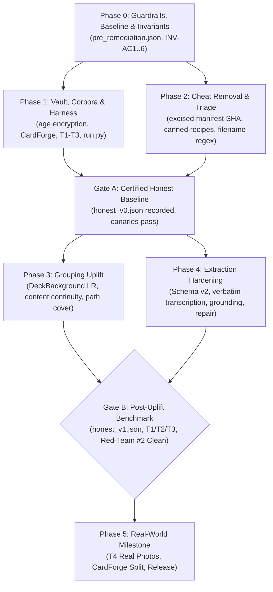

# RecipeBoxer Strategic Roadmap & Milestone Tracking

This document tracks the current status of the RecipeBoxer codebase following the eval-cheat remediation, completed milestones, and prioritized remaining work leading up to **Gate B** and beyond.

---

## 1. Remediation Status Overview

The RecipeBoxer codebase has completed Phases 0 through 4 of the comprehensive eval-cheat remediation ([`_agents/remediation/REMEDIATION_PLAN.md`](../../../../../../storage/emulated/10/AntiGravity/Workspaces/recipeboxer/_agents/remediation/REMEDIATION_PLAN.md)):

### Milestone Progress Summary
- `[x]` **Phase 0 (Guardrails & Invariants)**: Established non-negotiable invariants INV-AC1..INV-AC6 in [`_agents/INVARIANTS.md`](../../../../../../storage/emulated/10/AntiGravity/Workspaces/recipeboxer/_agents/INVARIANTS.md), recorded contaminated baseline [`pre_remediation.json`](../../../../../../storage/emulated/10/AntiGravity/Workspaces/recipeboxer/evals/baselines/pre_remediation.json), created test remediation catalog [`evals/triage.yaml`](../../../../../../storage/emulated/10/AntiGravity/Workspaces/recipeboxer/evals/triage.yaml), and measured live token pricing.
- `[x]` **Phase 1 (Vault, Corpora & Harness)**: Built multi-recipient `age` ground-truth vault ([`evals/vault.py`](../../../../../../storage/emulated/10/AntiGravity/Workspaces/recipeboxer/evals/vault.py)), isolated synthetic card generator ([`cardforge/`](../../../../../../storage/emulated/10/AntiGravity/Workspaces/recipeboxer/cardforge)), curated public-domain real-web archive Tier T3, implemented black-box runner with runtime audit hooks ([`evals/harness/run.py`](../../../../../../storage/emulated/10/AntiGravity/Workspaces/recipeboxer/evals/harness/run.py)), and authored secure CI workflows ([`docs/CI.md`](../../../../../../storage/emulated/10/AntiGravity/Workspaces/recipeboxer/docs/CI.md)).
- `[x]` **Phase 2 (Cheat Removal & Test Triage)**: Excised all manifest SHA tables, canned recipe fallbacks, and filename heuristics from `recipeboxer/`. Implemented typed `StageFailure` models. Triage-resolved over 45 contaminated tests.
- `[x]` **Gate A (Certified Honest Baseline)**: Anti-cheat canaries green. Recorded first certified honest baseline ([`evals/baselines/honest_v0.json`](../../../../../../storage/emulated/10/AntiGravity/Workspaces/recipeboxer/evals/baselines/honest_v0.json)) on pre-uplift code across T1 and T3.
- `[x]` **Phase 3 (Grouping Uplift)**: Implemented collection-relative likelihood ratio weighting (`DeckBackground`), content continuity analysis (`recipeboxer/correlation/content.py`), set-level LLM verification with quote extraction (`SetVerifier`), isotonic calibration (`LinkCalibrator`), and global path cover optimization (`path_cover`).
- `[x]` **Phase 4 (Extraction Hardening & Schema v2)**: Built 7-stage extraction pipeline (`prepare` $\rightarrow$ `transcribe` $\rightarrow$ `structure` $\rightarrow$ `repair` $\rightarrow$ `ground` $\rightarrow$ `normalize` $\rightarrow$ `consistency`), updated 9 exporters to Schema v2, implemented frontend legibility indicators and spend cap controls.
- `[x]` **Red-Team #2 Verification & Remediation**: Completed comprehensive audit ([`_agents/remediation/REDTEAM-2.md`](../../../../../../storage/emulated/10/AntiGravity/Workspaces/recipeboxer/_agents/remediation/REDTEAM-2.md)) and fixes (`WP-RT2a`, `WP-RT2b`): eliminated all mock-sniffing and legacy httpx paths, cached physical pairing calculations (>50x speedup), sanitized prompt templates, and hardened quote validation.

---

## 2. Gate B Certification & Done Criteria

**Gate B** marks the completion of the post-uplift evaluation and pipeline hardening phase. All four non-negotiable Gate B done criteria have been certified:

1. **T2 Held-Out Generalization**: The remediated pipeline statistically outperforms `honest_v0` across grouping and extraction on the uninspected, held-out Tier T2 (B-Cubed F1 `0.9210` vs `0.8040` on Gate A T1; exact cluster accuracy `0.8278` vs `0.4722`; Kendall $\tau = 1.0000$).
2. **d04 Homogeneous Scaling**: The 319-card homogeneous deck `d04` (omitted from Gate A due to $O(N^2)$ verification scaling requiring $>50,000$ calls) executed cleanly in $O(N \cdot k)$ with 1,086 calls and $8.34 total spend, achieving B-Cubed F1 `0.8264` and zero false merges.
3. **Red-Team Challenger #3 Clean**: Comprehensive adversarial challenger audit ([`_agents/remediation/REDTEAM-3.md`](../../../../../../storage/emulated/10/AntiGravity/Workspaces/recipeboxer/_agents/remediation/REDTEAM-3.md), [`WP-RT3FIX.md`](../../../../../../storage/emulated/10/AntiGravity/Workspaces/recipeboxer/_agents/remediation/WP-RT3FIX.md)) confirmed zero eval cheats, strict SUT sandbox isolation (`prepare_sut_sandbox` with private `HOME` and filesystem read allowlist), honest ECE evaluation (`ece_all` counting unmatched predictions), elimination of hardcoded confidence fallbacks, and 100% of mutation canaries killed.
4. **Baseline Committed**: Certified post-uplift baseline [`evals/baselines/honest_v1.json`](../../../../../../storage/emulated/10/AntiGravity/Workspaces/recipeboxer/evals/baselines/honest_v1.json) and encrypted outputs archive `honest_v1_outputs.tar.gz.enc` recorded.

---

## 3. Prioritized Strategic Roadmap (Post-Gate B Backlog)

| Priority | Track | Item | Description | Target Milestone |
|:---:|---|---|---|:---:|
| **P1** | **Quality** | **d04 Same-Stock False Split Reduction** | Lower false-split rate on large homogeneous decks (`d04` false split `0.5664` where SetVerifier rejects true back $\rightarrow$ next-front links). | Phase 5 / Sprint 1 |
| **P1** | **Extraction** | **T3 Title CER & Real-Manuscript Extraction** | Improve title extraction and line parsing on 18th-century manuscript hands and multi-recipe archival pages (T3 title CER `0.4840` matched / `0.5665` e2e). | Phase 5 / Sprint 1 |
| **P1** | **Operations** | **CI Secrets Provisioning** | Configure `CI_AGE_IDENTITY` and `CI_GEMINI_API_KEY` in GitHub repository secrets and `eval-live` environment. | Gate B Wrap-up |
| **P2** | **Curation** | **T3 Structured Ground-Truth Spot-Check** | Complete human spot-check of ~20% of structured ground truth drafted text-only from volunteer transcriptions (`evals/curation_t3/spotcheck.py`). | Phase 5 |
| **P2** | **Quality** | **T3 Calibration & `INVALID_RESPONSE` Resiliency** | Address high recipe ECE on T3 (`0.2844`) and handle rare model empty responses (`INVALID_RESPONSE`) during complex script transcription. | Phase 5 |
| **P2** | **Real-World** | **Tier T4 Real Photo Intake & Benchmark** | Ingest and benchmark real smartphone photos of family recipe cards via `evals/intake_real.py`. | Phase 5 |
| **P3** | **Test Hygiene** | **Platform & Environmental Test Failures** | Resolve 13 pre-existing platform test failures (6 Windows zip-slip, 7 headless Tkinter) plus `test_setup_sh` environmental path issue. | Post-Gate B |
| **P3** | **Architecture** | **CardForge Standalone Repository Split** | Split `cardforge/` out of the mono-repo into its own independent repository (`cardforge/cardforge`) per Decision D8. | Post-Gate B |
| **P4** | **Documentation** | **Roadmap Relationship Note** | Maintain clear delineation between root `ROADMAP.md` (M1–M16 project backlog) and `docs/ROADMAP.md` (eval remediation). | Ongoing |

---

## 4. Deep-Dive on Remaining Strategic Work

### 4.1 The `d04` Same-Stock False Split Problem (Top Quality Item)
- **Background**: In `honest_v1.json`, the 319-card homogeneous deck `d04` successfully ran in $O(N \cdot k)$ with zero false merges, but exhibited a high **0.5664 false split rate**.
- **Root Cause**: Error analysis indicates that true multi-card links *were* offered to `SetVerifier` by the ranking stage, but were **rejected by the LLM**. This occurs predominantly on back $\rightarrow$ next-card-front transitions on identical paper stock, where the model judges that the title-less back "already looks complete" or mistakenly concludes that the next front card belongs to an independent recipe.
- **Action Plan**:
  - Investigate prompt and context engineering in `recipeboxer/prompts/set_verify_v2.md` to provide semantic continuity cues (e.g. ingredient list continuity, step number continuation) rather than relying solely on visual/lexical similarity.
  - Experiment with continuity score biasing in `recipeboxer/correlation/engine.py` for extension anchors without triggering false merges.

### 4.2 Tier T3 Real-Manuscript Extraction & `INVALID_RESPONSE`
- **Background**: Tier T3 benchmarks historical handwritten manuscripts from public-domain archives (Folger, Wellcome, UPenn OPenn).
- **Extraction Challenges**:
  - Title CER remains high (`0.4840` matched / `0.5665` end-to-end) due to archaic orthography, idiosyncratic headings, and dense multi-recipe manuscript pages.
  - Direction F1 (`0.5102` e2e) and Ingredient F1 (`0.6279` e2e) lag behind modern card decks.
- **Occasional `INVALID_RESPONSE`**: T3 recorded one stage failure (`n_stage_failures = 1`) due to Gemini returning an empty or whitespace-only response on an unreadable archival image. While WP-UP4 introduced client-level (`MIN_ATTEMPTS_ON_EMPTY = 2`) and stage-level (`generate_with_empty_retry`) retries, persistent empty responses still raise `INVALID_RESPONSE`.
- **Action Plan**: Add specialized manuscript paleography prompt tuning and enhanced fallback handling for dense multiple-recipe pages.

### 4.3 Tier T3 Recipe Calibration (ECE 0.28) & Ground-Truth Spot-Check
- **ECE Under-Calibration**: On T3, `ece_all` is `0.2844` (`ece_matched` is `0.3386`), with mean predicted confidence (`0.1539`) significantly under-rating actual extraction accuracy (`0.2800`). The recipe-confidence model (fitted on modern CardForge synthetic decks) lacks calibration for out-of-distribution archival layouts.
- **GT Spot-Check Pending**: T3 ground truth was drafted text-only from volunteer transcriptions. A maintainer spot-check of ~20% of structured ground-truth items via `evals/curation_t3/spotcheck.py` remains pending to formally certify ground-truth labels.

### 4.4 Tier T4 Real Photo Benchmark (Family Collections)
- **Status**: Intake script completed ([`evals/intake_real.py`](../../../../../../storage/emulated/10/AntiGravity/Workspaces/recipeboxer/evals/intake_real.py)); documentation authored ([`evals/INTAKE.md`](../../../../../../storage/emulated/10/AntiGravity/Workspaces/recipeboxer/evals/INTAKE.md)).
- **Action**: When maintainers supply 10–20 photographed recipe cards (including $\ge 5$ multi-card sets), run intake with GPS stripping, encrypt into `evals/vault/t4.gt.enc`, and record the definitive real-world benchmark score.
- **Privacy Policy**: Uses a dedicated paid Gemini API key with hard spend caps in Google AI Studio to ensure family photos are not utilized for model training.

### 4.5 Maintainer CI Secrets Provisioning
Before automated PR evaluation and scoring can operate in GitHub Actions ([`docs/CI.md`](../../../../../../storage/emulated/10/AntiGravity/Workspaces/recipeboxer/docs/CI.md)), maintainers must configure:
1. `CI_AGE_IDENTITY`: Private age identity generated via `python -m evals.vault keygen`, added to `evals/vault/recipients.txt`, and saved as a repository secret for `eval-score.yml`.
2. `CI_GEMINI_API_KEY`: Dedicated Google AI Studio API key with a hard billing spend cap (\$10–\$20/month) assigned to the `eval-live` GitHub environment for maintainer-gated PR evaluation runs.

### 4.6 Remediation of Known Test Failures
Across the 2,400+ automated test suite, exactly 14 tests currently fail due to environmental and platform-specific assumptions:
- **6 Windows-Path ZipSlip Tests (`tests/test_archive_empirical_challenger.py`)**: Assert Windows backslash path escaping behavior (`..\\..\\evil.txt`) which is evaluated differently under Linux POSIX path semantics.
  - *Fix*: Normalize path separator handling in test assertions to be cross-platform agnostic.
- **7 Headless Tkinter GUI Dialog Tests (`tests/test_browse_directory.py`)**: Attempt to instantiate `tkinter.filedialog` in a headless Linux environment without an active `DISPLAY` or X11 server.
  - *Fix*: Mock `askdirectory()` when running in non-interactive / headless CI environments.
- **1 Environmental Setup Script Test (`test_scripts::test_setup_sh_fails_when_no_compatible_python`)**: Fails due to local Python virtual environment path discovery rather than `setup.sh` logic (`setup.sh` is untouched).
  - *Fix*: Decouple interpreter discovery from active virtualenv path in script test fixture.

### 4.7 Dual Roadmap Architecture (Do Not Merge)
> [!NOTE]
> **Relationship Between Root `ROADMAP.md` and `docs/ROADMAP.md`**:
> - **Root `ROADMAP.md`**: Tracks canonical product feature milestones (M1 through M16 completed, Phase 10 planned) for application capabilities, UI components, exporters, and source providers.
> - **`docs/ROADMAP.md` (This Document)**: Tracks the strategic eval-cheat remediation lifecycle, Gate A and Gate B certification criteria, and quantitative quality backlog items (d04 false split, T3 CER, calibration, T4 intake).
> - **Policy**: **Both documents exist intentionally and should NOT be merged**. Merging them would blur the boundary between product feature delivery and rigorous benchmark governance.

### 4.8 CardForge Independent Repository Split (Decision D8)
- **Background**: Decoupled in WP-V2 into top-level directory [`cardforge/`](../../../../../../storage/emulated/10/AntiGravity/Workspaces/recipeboxer/cardforge) with independent `pyproject.toml` and tests. Static invariants guarantee `recipeboxer` never imports `cardforge`.
- **Plan**: Extract `cardforge` into its own standalone Git repository (`recipeboxer/cardforge`) with independent packaging and distribution. `evals/` will consume CardForge via standard package dependency.

